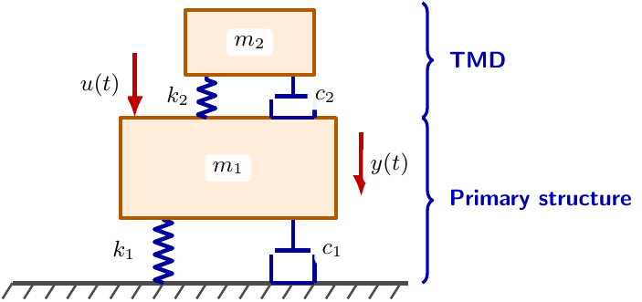
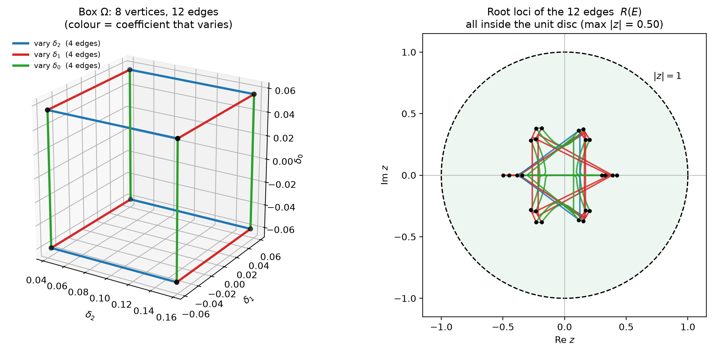
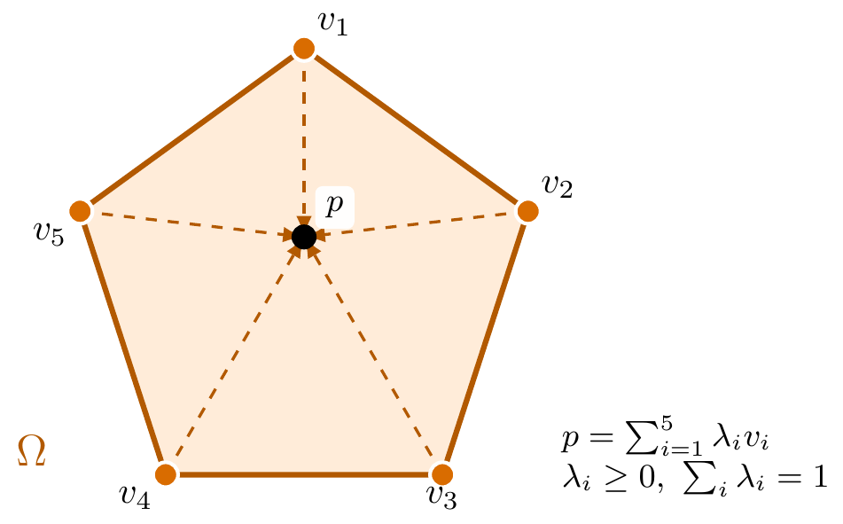
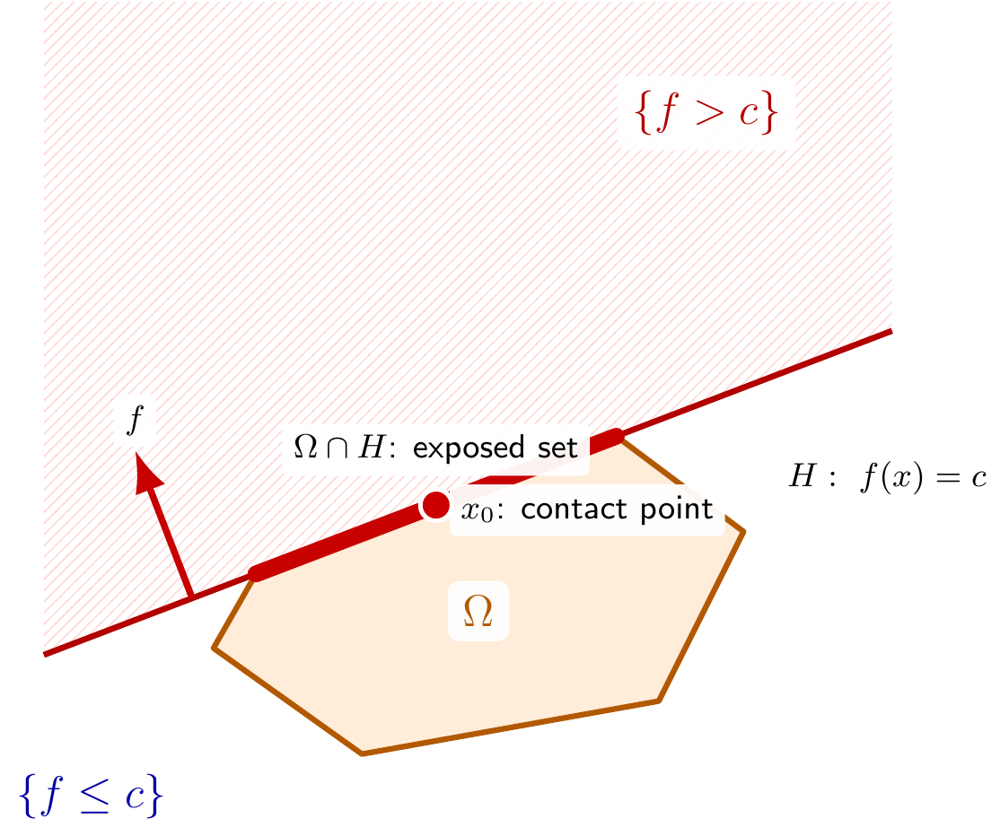
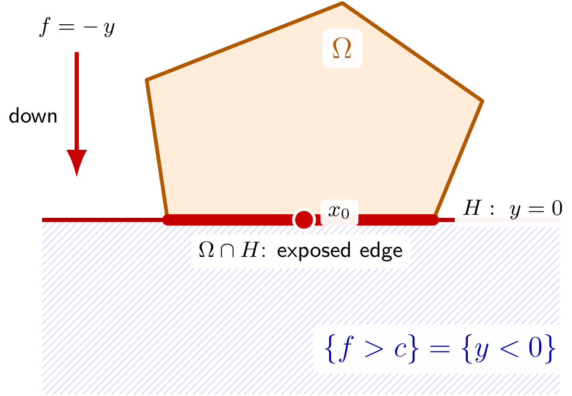
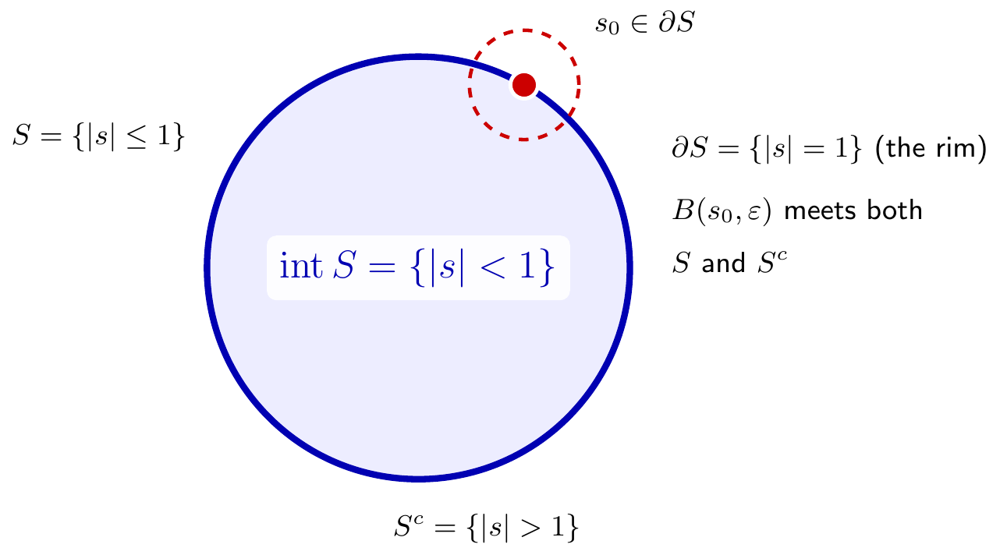
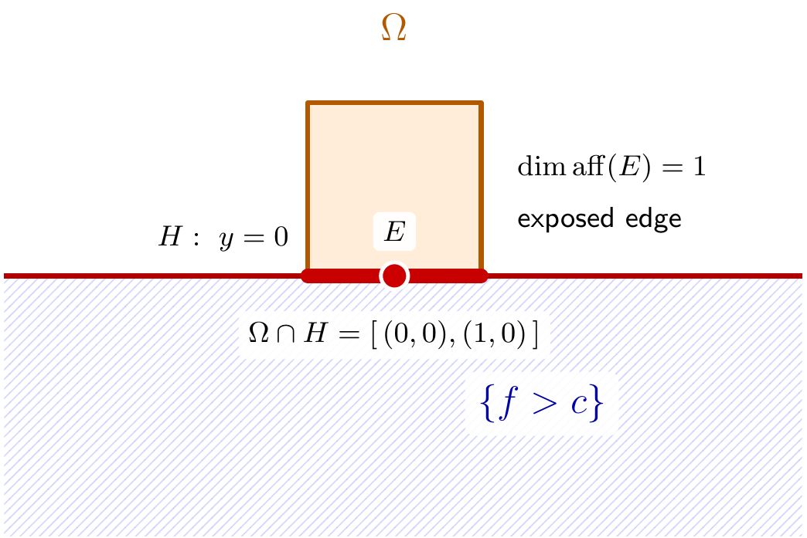
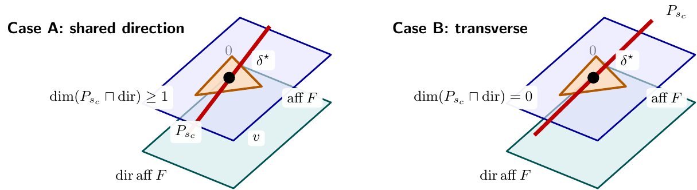

<!-- _class: lead -->

<!-- SLIDE 1 | Edge Theorem in Lean 4 (Lemma 6.1, real case) -->
# Edge Theorem in Lean 4 (Lemma 6.1, real case)
## TODO: subtitle — polytopic families and exposed edges

TODO: Author Name · Institute

---
<!-- _class: list -->

<!-- SLIDE 2 | Outline -->
# Outline

1. **Background** — Why the Edge Theorem is needed in Control Systems 
2. **Preliminaries** — coefficient vectors, polytopes, affine span/direction/dimension, supporting hyperplanes, root spaces
3. **Exposed faces and edges** — boundary geometry and examples
4. **Edge Theorem** — Assumption 6.1, Lemmas 6.1–6.2, theorem, how the lemmas fit
5. **Proof of Lemma 6.1 (real case)** — Steps 1–6 in Lean, recap, complex-case extra
6. **Proof of Lemma 6.2 (real case)** — goal, math proof, helper lemma, Lean walkthroughs, maps, complex-case extra
7. **Edge Theorem assembled** — formal proof, lemmas behind the steps, Lean implementation

---
<!-- SLIDE 3 | What is a control system? -->
# What is a control system?

> A **control system** manages, commands, directs, or regulates the behavior of other devices or systems using control loops — from simple applications like a home thermostat to complex industrial processes.

**Continuous-time state-space model:**
$$
\dot{x}(t) = A x(t) + B u(t)
$$
$$
y(t) = C x(t) + D u(t)
$$

**Discrete-time state-space model:**
$$
x[k+1] = A_d x[k] + B_d u[k]
$$
$$
y[k] = C_d x[k] + D_d u[k]
$$

**Where:** $x$ is the state vector 
 $y$ the output vector
  $u$ the input (control) vector 
  $A, B, C, D$ the state, input, output, and feedthrough matrices, respectively.

---

<!-- SLIDE 4 | From state-space to transfer function -->
# From state-space to transfer function

Starting from $\dot{x}(t) = Ax(t) + Bu(t)$, $y(t) = Cx(t) + Du(t)$, with zero initial conditions ($x(0) = 0$):

Applying Laplace transform: 
$sX(s) = AX(s) + BU(s)$, $Y(s) = CX(s) + DU(s)$.
$(sI - A)X(s) = BU(s)$, 
so $X(s) = (sI - A)^{-1}BU(s)$.
$\implies Y(s) = C(sI - A)^{-1}BU(s) + DU(s)$.

$G(s) = \dfrac{Y(s)}{U(s)} = C(sI - A)^{-1}B + D$ — the **transfer function**.

---

<!-- SLIDE 5 | Example: mass-spring-damper -->
# Example: mass-spring-damper

$m = 1\,\mathrm{kg}$, $c = 2\,\mathrm{N{\cdot}s/m}$, $k = 3\,\mathrm{N/m}$; input $u(t)$ = force (N), output $y(t)$ = displacement (m).
$$m\ddot{y} + c\dot{y} + ky = u(t) \quad\Rightarrow\quad \ddot{y} + 2\dot{y} + 3y = u(t)$$
States $x_1 = y$ (position), $x_2 = \dot{y}$ (velocity):
$$\begin{cases} \dot{x}_1 = x_2 \\ \dot{x}_2 = -3x_1 - 2x_2 + u \end{cases}
\qquad\Rightarrow\qquad
A = \begin{bmatrix} 0 & 1 \\ -3 & -2 \end{bmatrix},\;
B = \begin{bmatrix} 0 \\ 1 \end{bmatrix},\;
C = \begin{bmatrix} 1 & 0 \end{bmatrix},\;
D = 0$$

$G(s) = C(sI-A)^{-1}B + D
= \begin{bmatrix} 1 & 0 \end{bmatrix}
\frac{1}{s^2+2s+3}\begin{bmatrix} s+2 & 1 \\ -3 & s \end{bmatrix}
\begin{bmatrix} 0 \\ 1 \end{bmatrix}
= \dfrac{1}{s^2+2s+3}$

---

<!-- SLIDE 6 | Poles and stability -->
# Poles and stability

> **Stability criterion.** A system is **stable** iff all poles of $G(s)$ have strictly negative real parts; it is **unstable** if some pole of $G(s)$ has positive real part.

**Example.** $G(s) = \dfrac{1}{s^2+2s+3}$: the poles solve $s^2 + 2s + 3 = 0$,
$$s = \frac{-b \pm \sqrt{b^2-4ac}}{2a} = \frac{-2 \pm \sqrt{-8}}{2} = -1 \pm j\sqrt{2}$$
so with $p_1 = -1 + j\sqrt{2}$ and $p_2 = -1 - j\sqrt{2}$,
$\mathrm{Re}(p_1) = \mathrm{Re}(p_2) = -1 < 0$ $\Rightarrow$ the system is **stable**. 

---

<!-- SLIDE 7 | Kharitonov's theorem -->
# Kharitonov's theorem

Interval family $\mathcal{P} = \{p(s) = a_n s^n + \cdots + a_1 s + a_0 \mid a_i \in [\underline{a}_i, \bar{a}_i],\ \bar{a}_n > 0\}$. Four vertex polynomials:
$$K_1 = \underline{a}_n s^n + \underline{a}_{n-1}s^{n-1} + \bar{a}_{n-2}s^{n-2} + \bar{a}_{n-3}s^{n-3} + \cdots$$
$$K_2 = \bar{a}_n s^n + \bar{a}_{n-1}s^{n-1} + \underline{a}_{n-2}s^{n-2} + \underline{a}_{n-3}s^{n-3} + \cdots$$
$$K_3 = \underline{a}_n s^n + \bar{a}_{n-1}s^{n-1} + \bar{a}_{n-2}s^{n-2} + \underline{a}_{n-3}s^{n-3} + \cdots$$
$$K_4 = \bar{a}_n s^n + \underline{a}_{n-1}s^{n-1} + \underline{a}_{n-2}s^{n-2} + \bar{a}_{n-3}s^{n-3} + \cdots$$
$$\mathcal{P}\ \text{Hurwitz stable} \iff K_1, K_2, K_3, K_4\ \text{each Hurwitz stable.}$$

**Example (primary structure + TMD).** Primary: $m_1 \in [\underline{m}_1, \bar{m}_1]$, $k_1 \in [\underline{k}_1, \bar{k}_1]$, $c_1 \in [\underline{c}_1, \bar{c}_1]$; tuned mass damper: $m_2 \in [\underline{m}_2, \bar{m}_2]$, $k_2 \in [\underline{k}_2, \bar{k}_2]$, $c_2 \in [\underline{c}_2, \bar{c}_2]$. The equations of motion give $p(s) = a_4 s^4 + a_3 s^3 + a_2 s^2 + a_1 s + a_0 = 0$ with $a_i \in [\underline{a}_i, \bar{a}_i]$ — an interval family, so these four polynomials decide its stability.

<figure class="fig-card"></figure>

---

<!-- SLIDE 8 | Kharitonov vs Edge Theorem (discrete systems) -->
# Kharitonov vs Edge Theorem (discrete systems)

### Why Kharitonov fails (discrete)
- Kharitonov's proof relies on a special even/odd symmetry of the imaginary axis. The unit circle has no such symmetry, so four stable corner polynomials prove nothing — an unstable member can still hide in the family.
- A bilinear map sends the disc to the half-plane, but it mixes all coefficients together

### Counterexample: Kharitonov fails (discrete)
- Interval family $p(z) = a_3 z^3 + a_2 z^2 + a_1 z + a_0$ with $a_0 \in [-0.2, 0.5]$, $a_1 \in [0.3, 0.5]$, $a_2 \in [0.6, 1.3]$, $a_3 \in [0.9, 1.2]$.
- All four Kharitonov polynomials are stable (largest root moduli $0.83$, $0.79$, $0.98$, $0.82$ — all $< 1$).
- But the vertex member $p^\star(z) = 0.9z^3 + 1.3z^2 + 0.3z + 0.5$ has a root of modulus $1.47 > 1$ — unstable. Four stable corners, yet the family is not stable. 

Discrete-time robustness needs polytopes, not intervals — and a theorem that works on any stability region.

---

<!-- SLIDE 9 | The Edge Theorem at work (discrete) -->
# The Edge Theorem at work (discrete)

**Theorem (Edge Theorem; Bartlett–Hollot–Lin 1988).** Let $\Omega$ be a polytope of fixed-degree polynomials. Then $\partial R(\Omega) \subseteq \bigcup_{E} R(E)$ over the exposed edges $E$ of $\Omega$. Hence the family is stable (Hurwitz, Schur, …) iff every exposed edge is — and each edge is a one-parameter family $a(\lambda) = (1-\lambda)a^{(1)} + \lambda a^{(2)}$, $\lambda \in [0,1]$.

**Example (Ch. 6, Ex. 6.2).** Family $\delta(z;\underline{\delta}) = z^3 + \delta_2 z^2 + \delta_1 z + \delta_0$ with $\underline{\delta} = (\delta_3,\delta_2,\delta_1,\delta_0) \in \Omega := \{1\} \times [0.042,0.158] \times [-0.058,0.058] \times [-0.06,0.056] \subset \mathbb{R}^4$: 
a compact $3$-dimensional box ($8$ vertices, $12$ edges) with leading coefficient $\equiv 1$.

<figure class="fig-card"><figcaption><b>Ex. 6.2:</b> the box (left) and its 12 edge root loci inside |z| < 1 (right)</figcaption></figure>

---
<!-- _class: fragment -->
*** The edge theorem applies to each 1-parameter family (edge) of polynomials. The 12 edges of the coefficient box each give a root locus inside |z| < 1. ***

<!-- SLIDE 10 | Section 1 · Preliminaries -->
<!-- _class: section -->
# Section 1 · Preliminaries

---

<!-- SLIDE 11 | Polytopic family of polynomials -->
# Polytopic family of polynomials

A polytopic family of polynomials can be thought of as the convex hull of a
finite number of points (polynomials). Mathematically, this can be represented as
the family

$$
P(s) = \lambda_1 P_1(s) + \cdots + \lambda_n P_n(s)
$$

where $P_i(s)$ are fixed real polynomials and the $\lambda_i$ are real with
$\lambda_i \geq 0$ and $\sum \lambda_i = 1$.

> **Definition (Polytope).**
> Let $v_1,\dots,v_N \in \mathbb{R}^d$. The *polytope* spanned by
> $v_1,\dots,v_N$ is the set of all convex combinations of these points:
> $$
> \Omega \;=\; \operatorname{conv}\{v_1,\dots,v_N\}
> \;=\;
> \left\{
> \sum_{i=1}^{N} \lambda_i\, v_i
> \;\middle|\;
> \lambda_i \in \mathbb{R},\; \lambda_i \ge 0,\;
> \sum_{i=1}^{N} \lambda_i = 1
> \right\}.
> $$
> Equivalently, $\Omega$ is compact and convex.

---

<!-- SLIDE 12 | Coefficient vectors (`CoeffVec`) -->
# Coefficient vectors (`CoeffVec`)

**Restatement.**
A degree-$n$ polynomial $\delta(s)=\delta_0+\delta_1 s+\cdots+\delta_n s^n$
is identified with its coefficient vector
$\underline\delta=(\delta_0,\delta_1,\dots,\delta_n)\in\mathbb{R}^{n+1}$.

**Lean** (`EdgeTheoremDefs.lean`):

EdgeTheoremDefs.lean

<pre>/-- Coefficient vector `(α₀,…,αₙ) : ℝ^{n+1}` for `δ(s) = α₀+α₁s+…+αₙsⁿ`. -/
abbrev CoeffVec (n : ℕ) := Fin (n + 1) → ℝ</pre>

EdgeTheoremDefs.lean:95-99

<pre>/-- Convert a coefficient vector α : Fin(n+1) → ℝ to a polynomial
    δ(s) = α(0) + α(1)·s + ... + α(n)·sⁿ
-/
noncomputable def polyOfVec {n : ℕ} (α : CoeffVec n) : Polynomial ℝ :=
  ∑ j : Fin (n + 1), Polynomial.monomial j.val (α j)</pre>

**Example** ($n=2$).
`CoeffVec 2` = `Fin 3 → ℝ`, i.e. $\mathbb{R}^3$. Take
$\alpha = (\alpha_0,\alpha_1,\alpha_2) = (1,\,-2,\,3)$, i.e.
$\alpha(0)=1,\ \alpha(1)=-2,\ \alpha(2)=3$. Then

$$
\texttt{polyOfVec}\ \alpha = 1 + (-2)\,s + 3\,s^2 = 3s^2 - 2s + 1.
$$

EdgeTheoremDefs.lean

<pre>-- α : CoeffVec 2,  α 0 = 1,  α 1 = -2,  α 2 = 3
-- polyOfVec α = 3s² - 2s + 1</pre>

<!-- _class: fragment -->
*** The coefficient vector uniquely determines the polynomial. This example shows α = (1, -2, 3) giving 3s² - 2s + 1. ***

---

<!-- SLIDE 13 | Polytope: Lean formalization -->
# Polytope: Lean formalization

**Lean** (`EdgeTheoremDefs.lean`):

EdgeTheoremDefs.lean

<pre>/--
A polytope Ω in coefficient space ℝ^{n+1}.
It is defined as the convex hull of a finite set of vertices V,
and is assumed to have nonempty topological interior.
-/
structure Polytope (n : ℕ) where
  vertices : Finset (CoeffVec n)
  nonempty  : vertices.Nonempty
  interior_nonempty : (interior (convexHull ℝ (vertices : Set (CoeffVec n)))).Nonempty

/-- The actual set Ω ⊆ ℝ^{n+1} as the convex hull of the vertices. -/
def Polytope.Ω (P : Polytope n) : Set (CoeffVec n) :=
  convexHull ℝ (P.vertices : Set (CoeffVec n))</pre>

> **Assumption.** The Lean `Polytope` structure additionally requires nonempty interior (`interior_nonempty`). Everything in this deck assumes it.

<figure class="fig-card"></figure>

---

<!-- SLIDE 14 | Affine span, direction, dimension — definition -->
# Affine span, direction, dimension — definition
> **Definition (Affine subspace).** $A \subseteq \mathbb{R}^{d}$ is affine iff $\forall x,y \in A,\ \forall t \in \mathbb{R},\ (1-t)x + t y \in A$: closed under lines. Equivalently $A = p + V$ for $p \in A$ and a linear subspace $V = \mathrm{dir}(A)$.

> **Definition (Affine span).** For $S \subseteq \mathbb{R}^{d}$, $\mathrm{aff}(S) = \bigcap\{A \text{ affine} \mid S \subseteq A\}$, the smallest affine subspace containing $S$.

> **Definition (Direction).** For an affine subspace $A$, $\mathrm{dir}(A) = \{v \mid \forall p \in A,\ p + v \in A\}$, the underlying linear subspace of translations preserving $A$.

> **Definition (Dimension).** For a linear subspace $U \subseteq \mathbb{R}^{d}$, $\dim U$ is the number of vectors in any basis of $U$, i.e. the maximal size of a linearly independent subset of $U$. For an affine subspace $A$, $\dim A := \dim \mathrm{dir}(A)$. Hence $\dim \mathrm{aff}(F) = 0$ means a point, $= 1$ a line, $= 2$ a plane.

**Lean** (`EdgeTheoremDefs.lean:341-354`): continued on the next slide.

---

<!-- SLIDE 15 | Affine span, direction, dimension — Lean -->
# Affine span, direction, dimension — Lean

EdgeTheoremDefs.lean:338-351

<pre>abbrev meetDir (n : ℕ) (U : Submodule ℝ (CoeffVec n))
    (affΩ : AffineSubspace ℝ (CoeffVec n)) : Submodule ℝ (CoeffVec n) :=
  (affineSpan ℝ ((U : Set (CoeffVec n)) ∩ (affΩ : Set (CoeffVec n)))).direction

noncomputable abbrev dim {M : Type*} [AddCommGroup M] [Module ℝ M]
    (U : Submodule ℝ M) : ℕ :=
  Module.finrank ℝ U</pre>

---

<!-- SLIDE 16 | Supporting hyperplane -->
# Supporting hyperplane

> **Definition (Supporting hyperplane).**
> Let $\Omega \subseteq \mathbb{R}^{d}$ be convex and
> $f : \mathbb{R}^{d} \to \mathbb{R}$ a nonzero linear functional. The affine set
> $H = \{\, x \in \mathbb{R}^{d} : f(x) = c \,\}$ is a *supporting hyperplane*
> of $\Omega$ if
> **(i)** $f(x) \le c$ for all $x \in \Omega$
> **(ii)** $f(x_{0}) = c$ for some $x_{0} \in \Omega$.
> The *exposed set* is $\Omega \cap H$.

<!--

<figure class="fig-card"><figcaption>

<b>Supporting hyperplane:</b> $\Omega\subseteq\{f\le c\}$, the shaded side is $\{f>c\}$, and the flat part $\Omega\cap H$ of $\partial\Omega$ touches $H$ at $x_0$

</figcaption></figure>

 -->

> **Example (Concrete supporting hyperplane).**
> Take $f(x,y) = -y$ and $c = 0$.
> $H = \{\, (x,y) : y = 0 \,\}$
> is the $x$-axis. The polytope $\Omega$ lies above it, so
> $f(x,y) = -y \le 0 = c$ on $\Omega$, and the point
> $x_{0}$ belongs to both $\Omega$ and $H$.
> Hence $H$ supports $\Omega$, and the exposed set $\Omega \cap H$
> is the bottom edge of the polytope.

<figure class="fig-card"><figcaption>

<b>Example $f=-y$, $c=0$:</b> $\Omega$ above $H=\{y=0\}$; $\Omega \cap H$ is the bottom edge

</figcaption></figure>

---

<!-- SLIDE 17 | Supporting hyperplane: Lean -->
# Supporting hyperplane: Lean

**Lean** (`EdgeTheoremDefs.lean`):

EdgeTheoremDefs.lean

<pre>structure SupportingHyperplane (P : Polytope n) where
  f : CoeffVec n →ₗ[ℝ] ℝ
  c : ℝ
  nonzero : f ≠ 0
  upper_bound : ∀ x ∈ P.Ω, f x ≤ c
  touches : ∃ x ∈ P.Ω, f x = c</pre>

---

<!-- _class: section -->

<!-- SLIDE 18 | Root spaces -->
# Root spaces

---

<!-- SLIDE 19 | Root space — definition -->
# Root space — definition
**Notation.**
For $\delta = (\delta_0,\dots,\delta_n) \in \mathbb{R}^{n+1}$,
$\operatorname{polyOfVec}(\delta)(s)
= \delta_0 + \delta_1 s + \cdots + \delta_n s^n$.

> **Definition (Root space).**
> Let $W \subseteq \mathbb{R}^{n+1}$. Then
> $$
> R(W) = \{\, s \in \mathbb{C} \mid
> \exists\, \delta \in W,\ \delta(s) = 0 \,\},
> $$
> and for a polytope $P$, $R(P) := R(P.\Omega)$.

**Lean** (`EdgeTheoremDefs.lean`):

EdgeTheoremDefs.lean

<pre>def RootSpaceSet {n : ℕ}
  (W : Set (CoeffVec n)) : Set ℂ :=
  { s | ∃ δ ∈ W,
      ((polyOfVec δ).map (algebraMap ℝ ℂ)).IsRoot s }

/--
The root space of a polytope `P`: all complex numbers `s` such that
some coefficient vector in `P.Ω` yields a polynomial vanishing at `s`.
-/
def RootSpace (P : Polytope n) : Set ℂ :=
  RootSpaceSet P.Ω</pre>

---
<!-- _class: section -->

<!-- SLIDE 20 | Exposed faces and edges -->
# Exposed faces and edges

---

<!-- SLIDE 21 | Boundary and exposed faces — definition -->
# Boundary and exposed faces — definition
> **Definition (Closure and boundary).**
> $\overline{S} = \bigcap \{\, F \supseteq S : F
> \text{ closed} \,\}$ (smallest closed set containing $S$);
> $\partial S = \overline{S} \setminus \operatorname{int}(S)$.

> **Definition (Intrinsic interior / relative boundary).**
> For $S \subseteq \mathbb{R}^{d}$, the *intrinsic interior*
> $\operatorname{relint}(S)$ is the interior of $S$ relative to
> its affine span: $x \in \operatorname{relint}(S)$ iff
> $x \in S$ and $\exists\,\varepsilon > 0$ with
> $B(x, \varepsilon) \cap \operatorname{aff}(S) \subseteq S$.
> The *relative boundary* is $S \setminus \operatorname{relint}(S)$.

> **Definition (Exposed face / edge).**
> For $H$ supporting $\Omega$, $F = \Omega \cap H$ is
> *exposed*; $\dim\operatorname{aff}(F) = 1$ gives an
> *exposed edge* $E$, $= 2$ an *exposed face*.

**Lean** (`EdgeTheoremDefs.lean:140-151`)

---

<!-- SLIDE 22 | Boundary and exposed faces — Lean -->
# Boundary and exposed faces — Lean

EdgeTheoremDefs.lean:140-151

<pre>/-- The exposed face of `P` for `hp`: `F = Ω ∩ {x | hp.f x = hp.c}`. -/
def ExposedFace {n : ℕ} {P : Polytope n} (hp : SupportingHyperplane P) :
    Set (CoeffVec n) :=
  { x | x ∈ P.Ω ∧ hp.f x = hp.c }

open Affine

/-- `E` is an exposed edge of `P` if it is an exposed face of affine dimension 1. -/
def IsExposedEdge {n : ℕ} (P : Polytope n) (E : Set (CoeffVec n)) : Prop :=
  ∃ hp : SupportingHyperplane P,
    E = ExposedFace hp ∧
    Module.finrank ℝ (affineSpan ℝ (ExposedFace hp)).direction = 1</pre>

---

<!-- SLIDE 23 | Boundary and exposed edge — example -->
# Boundary and exposed edge — example

> **Example (Boundary).**
> $S = \{\, s : |s| \le 1 \,\}$ is closed, so
> $\overline{S} = S$, and
> $\operatorname{int}(S) = \{\, s : |s| < 1 \,\}$. Thus
> $\partial S = \{\, s : |s| = 1 \,\}$.

<figure class="fig-card"><figcaption>

<b>Boundary:</b> $\operatorname{int}(S)=\{|s|<1\}$, $\partial S=\{|s|=1\}$ — a small ball about $s_0$ meets both $S$ and $S^{c}$

</figcaption></figure>

> **Example (Exposed edge).**
> Let $\Omega = \operatorname{conv}\{(0,0),(1,0),(1,1),(0,1)\}$
> (unit square) and $H = \{(x,y) : -y = 0\}$. Then
> $\Omega \cap H = [\,(0,0),\,(1,0)\,]$
> with $\dim\operatorname{aff}(\Omega \cap H) = 1$:
> an exposed edge.

<figure class="fig-card"><figcaption>

<b>Exposed edge:</b> $H=\{y=0\}$ cuts the unit square in the segment $[\,(0,0),(1,0)\,]$, of affine dimension $1$

</figcaption></figure>

---
<!-- _class: section -->

<!-- SLIDE 24 | Edge Theorem -->
# Edge Theorem

---

<!-- SLIDE 25 | Assumption 6.1 -->
# Assumption 6.1

> **Assumption 6.1.**
> The sign of the leading coefficient $\delta_n$ is constant
> on $\Omega$; e.g. $\delta_n > \Delta > 0$ for all
> $\underline\delta \in \Omega$.

Every lemma and theorem below assumes it.

---

<!-- SLIDE 26 | Lemmas 6.1–6.2 — statements -->
# Lemmas 6.1–6.2 — statements
> **Lemma 6.1.**
> Let $\Omega \subset \mathbb{R}^{n+1}$ be a polytope satisfying
> Assumption 6.1. Then
> 1. If $s_r \in \mathbb{R}$ and $s_r \in R(\Omega)$,
>    then $\exists$ an exposed edge $E$ of $\Omega$ with
>    $s_r \in R(E)$;
> 2. If $s_c \in \mathbb{C}$ and
>    $s_c \in R(\Omega)$, then $\exists$ an exposed face
>    $F$ of $\Omega$ with $s_c \in R(F)$.

> **Lemma 6.2.**
> For any exposed face $F$ of $\Omega$,
> $$
> \partial R(F) \;\subseteq\; R(\partial F),
> $$
> i.e. the boundary of the root space of $F$ is contained
> in the root space of the relative boundary of $F$.

---

<!-- SLIDE 27 | Edge Theorem — statement -->
# Edge Theorem — statement
> **Theorem (Edge Theorem).**
> Let $\Omega \subset \mathbb{R}^{n+1}$ be a polytope of polynomials
> satisfying Assumption 6.1. Then the boundary of $R(\Omega)$
> is contained in the root space of the exposed edges of $\Omega$:
> $$
> \partial R(\Omega) \;\subseteq\;
> \bigcup_{E \text{ exposed edge}} R(E).
> $$

---

<!-- SLIDE 28 | Edge Theorem — proof outline -->
# Edge Theorem — proof outline
1. **Lemma 6.1.** Every $s \in R(\Omega)$ lies in $R(F)$ for some exposed face $F$ of $\Omega$; if $s = s_r \in \mathbb{R}$ then $F = E$ can be taken to be an exposed edge.
2. **Lemma 6.2.** For $F$ exposed, $\partial R(F) \subseteq R(\mathrm{rel}\,\partial F)$: a boundary root of a face is already a root on its relative boundary.
3. **Descent.** Let $s \in \partial R(\Omega)$. By (1), $s \in R(F_0)$ for $F_0$ exposed; while $s \in \partial R(F_k)$, (2) moves the root to $R(F_{k+1})$ for $F_{k+1} \subsetneq F_k$ exposed, so $\dim F_{k+1} < \dim F_k$. The dimension drops strictly at each step, hence the process terminates at an exposed edge $E$ with $s \in R(E)$.

Together: $\partial R(\Omega) \subseteq \bigcup_{E} R(E)$ over exposed edges $E$.

---
<!-- SLIDE 29 | Section 4 · Proof of Lemma 6.1, real case -->
<!-- _class: section -->
# Section 4 · Proof of Lemma 6.1, real case

---

<!-- SLIDE 30 | Lemma 6.1 (real case) — proof overview -->
# Lemma 6.1 (real case) — proof overview

> **Lemma 6.1.** :  Let $\Omega \subset \mathbb{R}^{n+1}$ be a polytope satisfying Assumption 6.1. Then
> 1. If $s_r \in \mathbb{R}$ and $s_r \in R(\Omega)$,
>    then $\exists$ an exposed edge $E$ of $\Omega$ with
>    $s_r \in R(E)$;
> 2. If $s_c \in \mathbb{C}$ and
>    $s_c \in R(\Omega)$, then $\exists$ an exposed face
>    $F$ of $\Omega$ with $s_c \in R(F)$.

1. **Unpack.** $s \in R(\Omega)$ with $\mathrm{Im}(s) = 0$ gives $\delta \in \Omega \cap P_{s_r}(r)$ with $s = \bar{r}$.
2. **Count.** $\dim U = n$ and $\dim\mathrm{dir} \ge 2$ give $\dim(U \cap \mathrm{dir}) \ge 1$.
3. **Escape.** Follow the nonzero direction to $\delta_{\mathrm{bound}} \in P_{s_r} \cap \partial\Omega$.
4. **Expose.** Hahn–Banach at $\delta_{\mathrm{bound}}$ gives exposed $F \ni \delta_{\mathrm{bound}}$ with $\bar{r} \in R(F)$.
5. **Descend.** $F \to G \to \cdots \to E$ with $\bar{r} \in R(E)$, $\dim E = 1$ (termination by dimension).
6. **Degenerate.** $m = 0$ is impossible; $m = 1$ makes $\Omega$ itself the edge.

---

<!-- SLIDE 31 | Step 1: Unpack the root — Lean + map -->
# Step 1: Unpack the root — Lean + map

**Claim.** Let $s \in R(\Omega)$ with $\mathrm{Im}(s) = 0$. Then $s = \bar{r}$ $\in R$ and there is $\delta \in P_{s_r}(r)$ with $\tilde P_\delta(s) = 0$.

**Proof.** $s \in R(\Omega)$ gives $\delta \in \Omega$ with $\tilde P_\delta(s) = 0$. 
 $\mathrm{Im}(s) = 0$ gives $s = \bar{r}$ ($r = \mathrm{Re}(s)$) by `Complex.ext`. 
  The root at $\bar{r}$ reads $P_\delta(r) = 0$, i.e. $\delta \in \ker(\mathrm{ev}_r) = P_{s_r}(r)$.

Lemma61.lean:142-153

<pre>theorem lemma61_real (hn : n ≥ 1) (P : Polytope n) (s : ℂ) (hs : s ∈ RootSpace P) :
    s.im = 0 → ∃ E, IsExposedEdge P E ∧ s ∈ RootSpaceSet E := by
  intro hreal
1.1  unfold RootSpace RootSpaceSet at hs
  obtain ⟨δ, hδ_in_Ω, hδ_root⟩ := hs
1.2  have hs_real : s = ↑s.re := by
    apply Complex.ext
    · simp
    · simp [hreal]
1.3  have hδ_in_Psr : δ ∈ (P_sr n s.re : Set (CoeffVec n)) := by
    rw [hs_real] at hδ_root
    exact mem_P_sr_of_isRoot s.re δ hδ_root</pre>

### Map

| Step | Content |
|:---|:---|
| **1.1** | $s \in R(\Omega)$ gives $\delta \in \Omega$ with $\tilde P_\delta(s) = 0$ |
| **1.2** | $\mathrm{Im}(s)=0$ gives $s = \bar{r}$ with $r = \mathrm{Re}(s)$ |
| **1.3** | Root at $\bar{r}$ gives $P_\delta(r) = 0$, i.e. $\delta \in P_{s_r}(r)$ |

---

<!-- SLIDE 32 | Step 2: Dimension count — Lean + map -->
# Step 2: Dimension count — Lean + map

**Claim.** Let $U$ be linear with $\dim U = n$, $\mathrm{aff}\Omega$ affine with $\dim(\mathrm{dir}(\mathrm{aff}\Omega)) \ge 2$, and $\delta \in U \cap \mathrm{aff}\Omega$. Then $\dim(\mathrm{meetDir}) \ge 1$.

**Proof.** $\mathrm{meetDir} = \mathrm{dir}(\mathrm{aff}(U \cap \mathrm{aff}\Omega))$ by definition. 
**2.2** Put $\mathrm{Aint} = U \sqcap \mathrm{aff}\Omega$. 
**2.3** $\mathrm{dir}(\mathrm{Aint}) = U \cap \mathrm{dir}(\mathrm{aff}\Omega)$ , Since $U$, viewed as an affine subspace, has direction $U$ itself
**2.4** $\mathrm{aff}(U \cap \mathrm{aff}\Omega) = \mathrm{Aint}$. 
**2.5** Hence $\dim(\mathrm{meetDir}) = \dim(U \cap \mathrm{dir}(\mathrm{aff}\Omega))$. 
**2.6** $\dim(U \cap V) = \dim U + \dim V - \dim(U+V) \ge n + 2 - (n+1) = 1$ , where $V$ is  $\mathrm{dir}(\mathrm{aff}\Omega)$ 

PreliminaryLemmas.lean

<pre>lemma intersection_affine_dim_ge_one {n : ℕ} (U : Submodule ℝ (CoeffVec n))
    (affΩ : AffineSubspace ℝ (CoeffVec n))
    (δ : CoeffVec n) (hδU : δ ∈ U) (hδΩ : δ ∈ affΩ)
    (hU_dim : dim U = n) (haff_dim : dim affΩ.direction ≥ 2) :
    dim (meetDir n U affΩ) ≥ 1 := by
2.1  unfold meetDir
2.2  let Aint : AffineSubspace ℝ (CoeffVec n) := U.toAffineSubspace ⊓ affΩ
2.3  have hA_dir : Aint.direction = U ⊓ affΩ.direction :=
    intersection_direction_eq U affΩ δ hδU hδΩ
2.4  have hA_eq : affineSpan ℝ ((U : Set (CoeffVec n)) ∩ (affΩ : Set (CoeffVec n))) = Aint := by
    rw [affineSpan_inter U affΩ]
2.5  rw [hA_eq, hA_dir]
2.6  exact finrank_inf_ge_one U affΩ.direction hU_dim haff_dim</pre>

### Map

| Step | Content |
|:---|:---|
| **2.1** | $\mathrm{meetDir} = \mathrm{dir}(\mathrm{aff}(U \cap \mathrm{aff}\Omega))$ by definition |
| **2.2** | $\mathrm{Aint} = U \sqcap \mathrm{aff}\Omega$ (infimum of affine subspaces) |
| **2.3** | $\mathrm{dir}(\mathrm{Aint}) = U \cap \mathrm{dir}(\mathrm{aff}\Omega)$ |
| **2.4** | $\mathrm{aff}(U \cap \mathrm{aff}\Omega) = \mathrm{Aint}$ (a subspace is affine) |
| **2.5** | Hence $\dim(\mathrm{meetDir}) = \dim(U \cap \mathrm{dir}(\mathrm{aff}\Omega))$ |
| **2.6** | $\dim(U \cap V) = \dim U + \dim V - \dim(U+V) \ge n + 2 - (n+1) = 1$ ,  |

<!-- _class: fragment -->
*** Step-by-step dimension analysis: each step reveals on a new slide ***

---
<!-- SLIDE 33 | Step 3: Escape — Lean + map -->
# Step 3: Escape — Lean + map

**Claim.** Let $\Omega$ be a polytope, $U$ a linear subspace, $\delta \in \Omega \cap U$, with $\dim(\mathrm{meetDir}) \ge 1$. Then $\exists\, \delta_{\mathrm{bound}} \in U \cap \partial\Omega$.

**Proof.** $\dim \ge 1$ gives $v \neq 0$ in $U \sqcap \mathrm{dir}(\mathrm{aff}\Omega)$. 
$\delta + tv \in U$ for all $t$ because $U$ is a subspace containing both $\delta$ and $v$; $\delta + tv \in \mathrm{aff}\Omega$ because an affine space contains the whole line through any of its points in any of its directions (line_in_intersection).
$\Omega$ is compact, hence bounded: all pairs lie at distance $\le C$. With $|v| > 0$ (from ①), $t_{\mathrm{out}} := (|C|+1)/|v| > 0$, and $\mathrm{dist}(\delta + t_{\mathrm{out}}v,, \delta) = |C|+1 > C$, so the point lies outside $\Omega$ (ray_escapes_of_bounded).
The segment $[\delta, \delta + t_{\mathrm{out}}v]$ meets $\partial\Omega$. 
$\delta_{\mathrm{bound}} = \delta + (c \cdot t_{\mathrm{out}})v \in U \cap \partial\Omega$.

<pre>lemma exists_boundary_point_in_submodule {n : ℕ} (P : Polytope n)
    (U : Submodule ℝ (CoeffVec n)) (δ : CoeffVec n)
    (hδ_in_Ω : δ ∈ P.Ω) (hδ_in_U : δ ∈ (U : Set (CoeffVec n)))
    (affΩ : AffineSubspace ℝ (CoeffVec n)) (hδ_aff : δ ∈ affΩ)
    (hA_dim : dim (meetDir n U affΩ) ≥ 1) :
    ∃ δ_bound, δ_bound ∈ (U : Set (CoeffVec n)) ∩ frontier P.Ω := by
①  have h_dim_pos : 0 < dim (meetDir n U affΩ) := by omega
  haveI : Nontrivial ↥(U ⊓ affΩ.direction) :=
    intersection_nontrivial U affΩ δ hδ_in_U hδ_aff h_dim_pos
  obtain ⟨v_sub, hv_sub_nonzero⟩ := exists_ne (0 : ↑(U ⊓ affΩ.direction))
②  let v : CoeffVec n := v_sub.val
  have h_line_in_intersection : ∀ (t : ℝ), δ + t • v ∈ (U : Set (CoeffVec n)) ∩
      (affΩ : Set (CoeffVec n)) :=
    line_in_intersection U affΩ δ hδ_in_U hδ_aff v_sub
③  have hv_nonzero : v ≠ 0 := by
    intro h; apply hv_sub_nonzero; exact Submodule.coe_eq_zero.mp h
  have h_escapes : ∃ (t : ℝ), 0 < t ∧ δ + t • v ∉ P.Ω :=
    ray_escapes_of_bounded P.isBounded δ v hδ_in_Ω hv_nonzero
  obtain ⟨t_out, ht_out_pos, ht_out⟩ := h_escapes
④  by_cases hδ_front : δ ∈ frontier P.Ω
  · exact ⟨δ, hδ_in_U, hδ_front⟩
  · obtain ⟨δ_bound, h_seg, h_front⟩ :=
      segment_boundary_intersection P δ hδ_in_Ω hδ_front v hv_nonzero t_out ht_out
⑤    rw [segment_eq_image] at h_seg
    obtain ⟨c, hc_in_Icc, hc_eq⟩ := h_seg
    have h_rewrite : (1 - c) • δ + c • (δ + t_out • v) = δ + (c * t_out) • v :=
      segment_point_rewrite δ v c t_out
    have h_mem := h_line_in_intersection (c * t_out)
    rcases h_mem with ⟨hmem_U, hmem_aff⟩
    have h_eq : δ_bound = δ + (c * t_out) • v := by
      calc δ_bound = (1 - c) • δ + c • (δ + t_out • v) := by rw [←hc_eq]
        _ = δ + (c * t_out) • v := by rw [h_rewrite]
    exact ⟨δ_bound, h_eq ▸ hmem_U, h_front⟩</pre>

### Map

| Step | Content |
|:---|:---|
| **①** | $\dim \ge 1$ makes $U \sqcap \mathrm{dir}(\mathrm{aff}\Omega)$ nontrivial, giving $v \neq 0$ |
| **②** | $\delta + tv$ stays in $U \cap \mathrm{aff}\Omega$: $U$ is a subspace, $\mathrm{aff}\Omega$ is affine |
| **③** | Bounded $\Omega$ gives $t_{\mathrm{out}} = (\|C\|+1)/\|v\| > 0$ with $\delta + t_{\mathrm{out}}v \notin \Omega$ (distance $\|C\|+1 > C$) |
| **④** | $[\delta, \delta + t_{\mathrm{out}}v]$ meets $\partial\Omega$ (or $\delta \in \partial\Omega$); else two disjoint opens disconnect it |
| **⑤** | $\delta_{\mathrm{bound}} = \delta + (c \cdot t_{\mathrm{out}})v$: on the line from ②, hence in $U$ — and in $\partial\Omega$ by ④ |

---

<!-- SLIDE 34 | Step 3: Escape — `exists_boundary_point_in_submodule` (Lean + map) -->
# Step 3: Escape — `exists_boundary_point_in_submodule` (Lean + map)

**Goal.** Let $\Omega \subset \mathbb{R}^{n+1}$ be a polytope, $U$ a linear subspace, $\delta \in \Omega \cap U$, with $\dim(\mathrm{meetDir}\,n\,U\,\mathrm{aff}\Omega) \ge 1$. Then $\exists\,\delta_{\mathrm{bound}} \in U \cap \partial\Omega$.

**Proof.** **3.1** $\dim \ge 1$ makes $U \sqcap \mathrm{dir}(\mathrm{aff}\Omega)$ nontrivial, giving $v_{\mathrm{sub}} \neq 0$. 
**3.2** With $v := v_{\mathrm{sub}}.\mathrm{val}$, the line $\delta + t \cdot v$ lies in $U \cap \mathrm{aff}\Omega$ for all $t$. 
**3.3** Boundedness of $\Omega$ gives $t_{\mathrm{out}} > 0$ with $\delta + t_{\mathrm{out}}v \notin \Omega$ (and $v \neq 0$ is inherited). 
**3.4** If $\delta \in \partial\Omega$ take $\delta_{\mathrm{bound}} = \delta$; else the segment $[\delta,\, \delta + t_{\mathrm{out}}v]$ meets $\partial\Omega$. 
**3.5** Rewriting gives $\delta_{\mathrm{bound}} = \delta + (c \cdot t_{\mathrm{out}})v \in U \cap \partial\Omega$.

PreliminaryLemmas.lean:336-368 — full proof, 3.1–3.5 highlighted

<pre>lemma exists_boundary_point_in_submodule {n : ℕ} (P : Polytope n)
    (U : Submodule ℝ (CoeffVec n)) (δ : CoeffVec n)
    (hδ_in_Ω : δ ∈ P.Ω) (hδ_in_U : δ ∈ (U : Set (CoeffVec n)))
    (affΩ : AffineSubspace ℝ (CoeffVec n)) (hδ_aff : δ ∈ affΩ)
    (hA_dim : dim (meetDir n U affΩ) ≥ 1) :
    ∃ δ_bound, δ_bound ∈ (U : Set (CoeffVec n)) ∩ frontier P.Ω := by
3.1  have h_dim_pos : 0 < dim (meetDir n U affΩ) := by omega
  haveI : Nontrivial ↥(U ⊓ affΩ.direction) :=
    intersection_nontrivial U affΩ δ hδ_in_U hδ_aff h_dim_pos
  obtain ⟨v_sub, hv_sub_nonzero⟩ := exists_ne (0 : ↑(U ⊓ affΩ.direction))
3.2  let v : CoeffVec n := v_sub.val
  have h_line_in_intersection : ∀ (t : ℝ), δ + t • v ∈ (U : Set (CoeffVec n)) ∩
      (affΩ : Set (CoeffVec n)) :=
    line_in_intersection U affΩ δ hδ_in_U hδ_aff v_sub
3.3  have hv_nonzero : v ≠ 0 := by
    intro h; apply hv_sub_nonzero; exact Submodule.coe_eq_zero.mp h
  have h_escapes : ∃ (t : ℝ), 0 < t ∧ δ + t • v ∉ P.Ω :=
    ray_escapes_of_bounded P.isBounded δ v hδ_in_Ω hv_nonzero
  obtain ⟨t_out, ht_out_pos, ht_out⟩ := h_escapes
3.4  by_cases hδ_front : δ ∈ frontier P.Ω
  · exact ⟨δ, hδ_in_U, hδ_front⟩
  · obtain ⟨δ_bound, h_seg, h_front⟩ :=
      segment_boundary_intersection P δ hδ_in_Ω hδ_front v hv_nonzero t_out ht_out
3.5    rw [segment_eq_image] at h_seg
    obtain ⟨c, hc_in_Icc, hc_eq⟩ := h_seg
    have h_rewrite : (1 - c) • δ + c • (δ + t_out • v) = δ + (c * t_out) • v :=
      segment_point_rewrite δ v c t_out
    have h_mem := h_line_in_intersection (c * t_out)
    rcases h_mem with ⟨hmem_U, hmem_aff⟩
    have h_eq : δ_bound = δ + (c * t_out) • v := by
      calc δ_bound = (1 - c) • δ + c • (δ + t_out • v) := by rw [←hc_eq]
        _ = δ + (c * t_out) • v := by rw [h_rewrite]
    exact ⟨δ_bound, h_eq ▸ hmem_U, h_front⟩</pre>

### Map

| Step | Content |
|:---|:---|
|  **3.1** | `dim(meetDir) ≥ 1 → U ⊓ dir` nontrivial → nonzero `v`  |
|  **3.2** | Line `δ + t • v ⊆ U ∩ affΩ`  |
|  **3.3** | `∃ t_out > 0, δ + t_out • v ∉ Ω` (`t_out = (\|C\|+1)/‖v‖`)  |
|  **3.4** | Segment `[δ, δ + t_out • v]` crosses `∂Ω` (connectedness)  |
|  **3.5** | The witness stays in the slice: $\delta_{\mathrm{bound}}$ on the segment gives $c \in [0,1]$ with $\delta_{\mathrm{bound}} = (1-c)\delta + c(\delta + t_{\mathrm{out}}v) = \delta + (c \cdot t_{\mathrm{out}})v$ (via `segment_eq_image`, `segment_point_rewrite`), a point of the line from 3.2, hence in $U$ — and in $\partial\Omega$ by 3.4 |

---

<!-- SLIDE 35 | Step 3: Escape — `ray_escapes_of_bounded` (Lean + map) -->
# Step 3: Escape — `ray_escapes_of_bounded` (Lean + map)

BasicLemmas.lean:73-91 — full proof, A.1.1–A.1.4 highlighted

<pre>lemma ray_escapes_of_bounded {n : ℕ} {S : Set (CoeffVec n)}
    (hB : Bornology.IsBounded S) (δ v : CoeffVec n)
    (hδ : δ ∈ S) (hv : v ≠ 0) : ∃ t : ℝ, 0 < t ∧ δ + t • v ∉ S := by
A.1.1  rcases Metric.isBounded_iff.mp hB with ⟨C, hC⟩
A.1.2  have hv_norm_pos : 0 < ‖v‖ := norm_pos_iff.mpr hv
  refine ⟨(|C| + 1) / ‖v‖, div_pos (by positivity) hv_norm_pos, ?_⟩
  intro h_contra
A.1.3  have ht_nonneg : (0 : ℝ) ≤ (|C| + 1) / ‖v‖ := (div_pos (by positivity) hv_norm_pos).le
  have h_dist : dist (δ + ((|C| + 1) / ‖v‖) • v) δ = ((|C| + 1) / ‖v‖) * ‖v‖ := by
    rw [dist_eq_norm]
    have h_sub : δ + ((|C| + 1) / ‖v‖) • v - δ = ((|C| + 1) / ‖v‖) • v := by abel
    rw [h_sub, norm_smul, Real.norm_eq_abs _,
      abs_of_nonneg ht_nonneg]
  have h_le : dist (δ + ((|C| + 1) / ‖v‖) • v) δ ≤ C := hC h_contra hδ
  have h_t_mul : ((|C| + 1) / ‖v‖) * ‖v‖ = |C| + 1 :=
    div_mul_cancel₀ _ (ne_of_gt hv_norm_pos)
A.1.4  rw [h_dist, h_t_mul] at h_le
  have : C ≤ |C| := le_abs_self C
  linarith</pre>

### Map

| Step | Content |
|:---|:---|
|  **A.1.1** | Boundedness gives radius $C$: $\mathrm{dist} \le C$ on $S$  |
|  **A.1.2** | $t_{out} = (\|C\|+1)/\|v\| > 0$ witnesses the existential  |
|  **A.1.3** | Four facts: (i) $t = (\|C\|+1)/\|v\| \ge 0$ — quotient of positives; (ii) $\mathrm{dist}(\delta + t{\cdot}v, \delta) = t\|v\|$ — distance is a norm, $\delta$ cancels, the scalar pulls out, $\|t\| = t$; (iii) that distance is $\le C$ — the boundedness hypothesis applied; (iv) $t\|v\| = \|C\|+1$ — division by nonzero $\|v\|$ cancels  |
|  **A.1.4** | $\|C\|+1 \le C \le \|C\|$, impossible  |

---

<!-- SLIDE 36 | Step 3: Escape — `segment_boundary_intersection` (Lean + map) -->
# Step 3: Escape — `segment_boundary_intersection` (Lean + map)

**Claim.** Let $\delta \in P.\Omega \setminus \mathrm{frontier}\,P.\Omega$, $v \neq 0$, and $t_{\mathrm{out}}$ with $\delta + t_{\mathrm{out}} \bullet v \notin P.\Omega$. Then $\exists\,\delta_{\mathrm{bound}} \in \mathrm{segment} [ \delta\ ,(\delta + t_{\mathrm{out}} \bullet v)$ ] with $\delta_{\mathrm{bound}} \in \mathrm{frontier}\,P.\Omega$.

**Proof.** **A.2.1** Assume $\Omega$ is closed and prove by contradiction (h_no_front : ∀ δ_bound ∈ segment ℝ δ (δ + t_out • v), δ_bound ∉ frontier P.Ω , and goal becomes false)
**A.2.2** The segment is then covered by the union of the two opens $\mathrm{int}\,\Omega$ and $\mathrm{int}(\Omega^c)$. Points in $\Omega$ off the frontier are interior since $\Omega$ is closed ($\partial\Omega = \Omega \setminus \mathrm{int}\,\Omega$), and points outside $\Omega$ lie in the open complement, hence in its interior. 
**A.2.3** Both opens meet the segment: $\delta$ lies in $\mathrm{int}\,\Omega$ (in $\Omega$ yet off the frontier), and $\delta + t_{\mathrm{out}}v$ lies in $\mathrm{int}(\Omega^c)$ (outside the closed $\Omega$); moreover the two opens are disjoint, $\mathrm{int}\,\Omega \cap \mathrm{int}(\Omega^c) = \emptyset$. 
**A.2.4** Connectedness of the segment forces a point in both — inside $\emptyset$, contradiction.

PreliminaryLemmas.lean:273-294 — A.2.1–A.2.4 highlighted

<pre>lemma segment_boundary_intersection {n : ℕ} (P : Polytope n) (δ : CoeffVec n)
    (hδ_in_Ω : δ ∈ P.Ω) (hδ_not_front : δ ∉ frontier P.Ω)
    (v : CoeffVec n) (_hv_nonzero : v ≠ 0) (t_out : ℝ) (ht_out : δ + t_out • v ∉ P.Ω) :
    ∃ δ_bound ∈ segment ℝ δ (δ + t_out • v), δ_bound ∈ frontier P.Ω := by
A.2.4  have h_conn : IsConnected (segment ℝ δ (δ + t_out • v)) :=
    segment_is_connected δ v t_out
A.2.1  have h_closed : IsClosed P.Ω := P.isCompact.isClosed
  by_contra h_no_front
  push_neg at h_no_front
A.2.2  have h_cover : segment ℝ δ (δ + t_out • v) ⊆ (interior P.Ω) ∪ interior (P.Ωᶜ) :=
    segment_cover_by_interior_and_complement P δ v t_out h_closed h_no_front
A.2.3  have h_in_u : (segment ℝ δ (δ + t_out • v) ∩ interior P.Ω).Nonempty :=
    segment_intersects_interior P δ v t_out hδ_in_Ω hδ_not_front h_closed
  have h_in_v : (segment ℝ δ (δ + t_out • v) ∩ interior (P.Ωᶜ)).Nonempty :=
    segment_intersects_complement_interior P δ v t_out ht_out h_closed
  have huv_empty : interior P.Ω ∩ interior (P.Ωᶜ) = ∅ :=
    interior_and_complement_interior_disjoint P
A.2.4  have h_pre := h_conn.2 (interior P.Ω) (interior (P.Ωᶜ)) isOpen_interior isOpen_interior
  have h_inter_nonempty := h_pre h_cover h_in_u h_in_v
  obtain ⟨x, hx_s, hx_uv⟩ := h_inter_nonempty
  rw [huv_empty] at hx_uv
  exact hx_uv</pre>

### Map

| Step | Content |
|:---|:---|
|  **A.2.1** | Assume no segment point hits the frontier; goal becomes `False`  |
|  **A.2.2** | Covered by $\mathrm{int}\,\Omega \cup \mathrm{int}(\Omega^c)$ (`frontier_eq_for_closed`)  |
|  **A.2.3** | Both opens meet the segment ($\delta \in \mathrm{int}\,\Omega$, $\delta + t_{\mathrm{out}}v \in \mathrm{int}(\Omega^c)$) and are disjoint |
|  **A.2.4** | `segment_is_connected` (`BasicLemmas.lean:46`) forces a point in both — in $\emptyset$  |

---

<!-- SLIDE 37 | Step 3: Escape — slice wrappers `Psr`/`Psc` (Lean + map) -->
# Step 3: Escape — slice wrappers `Psr`/`Psc` (Lean + map)

PreliminaryLemmas.lean:371-384

<pre>A.3lemma exists_boundary_point_in_Psr {n : ℕ} (P : Polytope n) (r : ℝ) (δ : CoeffVec n)
    (hδ_in_Ω : δ ∈ P.Ω) (hδ_in_Psr : δ ∈ PsrSet n r)
    (affΩ : AffineSubspace ℝ (CoeffVec n)) (hδ_aff : δ ∈ affΩ)
    (hA_dim : dim (meetDir n (P_sr n r) affΩ) ≥ 1) :
    ∃ δ_bound, δ_bound ∈ PsrSet n r ∩ frontier P.Ω :=
  exists_boundary_point_in_submodule P (P_sr n r) δ hδ_in_Ω hδ_in_Psr affΩ hδ_aff hA_dim

/-- Complex case (U = P_sc n s): thin wrapper over the generic lemma. -/
A.3lemma exists_boundary_point_in_Psc {n : ℕ} (P : Polytope n) (s : ℂ) (δ : CoeffVec n)
    (hδ_in_Ω : δ ∈ P.Ω) (hδ_in_Psc : δ ∈ PscSet n s)
    (affΩ : AffineSubspace ℝ (CoeffVec n)) (hδ_aff : δ ∈ affΩ)
    (hA_dim : dim (meetDir n (P_sc n s) affΩ) ≥ 1) :
    ∃ δ_bound, δ_bound ∈ PscSet n s ∩ frontier P.Ω :=
  exists_boundary_point_in_submodule P (P_sc n s) δ hδ_in_Ω hδ_in_Psc affΩ hδ_aff hA_dim</pre>

### Map

| Step | Content |
|:--|:--|
| **A.1** | `ray_escapes_of_bounded` (:73): $t_{out}$ = (\|C\|+1)/\|v\| outside $S$ |
| **A.2** | `segment_boundary_intersection` (:273): two-opens cover ⇒ $\partial\Omega$ hit (27j–27k) |
| **A.3** | `_in_Psr` / `_Psc` (:371,379): $U$ := $P_{s_r}$ / $P_{s_c}$ (this slide) |

---
<!-- SLIDE 38 | Step 4: Exposed face — Lean + map -->
# Step 4: Exposed face — Lean + map

**Claim.** Let $\delta_{\mathrm{bound}} \in \mathrm{frontier}\,P.\Omega \cap \mathrm{PsrSet}\,n\,r = =\; \{\,\delta \in \mathbb{R}^{n+1} \mid P_\delta(r) = 0\,\} \;=\; \{\,\delta \mid \delta_0 + \delta_1 r + \cdots + \delta_n r^n = 0\,\}$ with $(\mathrm{interior}\,P.\Omega).\mathrm{Nonempty}$. Then there exists $F$ with $\mathrm{IsExposedFace}\,P\,F \land \delta_{\mathrm{bound}} \in F \land (r:\mathbb{C}) \in \mathrm{RootSpaceSet}\,F$.

ExposedFaceLemmas.lean:96-136

<pre style="font-size:0.32em;line-height:1.08;padding:0 6px;">lemma exists_exposed_face_containing_boundary_point {n : ℕ} (P : Polytope n)
    (r : ℝ) (δ_bound : CoeffVec n)
    (hδ_bound_front : δ_bound ∈ frontier P.Ω)
    (hδ_bound_Psr : δ_bound ∈ PsrSet n r)
    (h_int_nonempty : (interior P.Ω).Nonempty) :
    ∃ F : Set (CoeffVec n), IsExposedFace P F ∧ δ_bound ∈ F ∧ (r : ℂ) ∈ RootSpaceSet F := by
4.1  have hδ_bound_in_Ω : δ_bound ∈ P.Ω := frontier_point_in_Ω P δ_bound hδ_bound_front
  have hδ_bound_not_int : δ_bound ∉ interior P.Ω :=
    frontier_point_not_interior P δ_bound hδ_bound_front
4.2  have h_convex : Convex ℝ P.Ω := convex_convexHull ℝ _
  have h_int_convex : Convex ℝ (interior P.Ω) := h_convex.interior
  have h_int_open : IsOpen (interior P.Ω) := isOpen_interior
4.3  obtain ⟨f, hf_strict⟩ :=
    geometric_hahn_banach_open_point h_int_convex h_int_open hδ_bound_not_int
4.4  have hf_ne : f ≠ 0 := supporting_func_nonzero P f δ_bound hf_strict h_int_nonempty
4.5  let c : ℝ := f δ_bound
4.4  let f_lin : CoeffVec n →ₗ[ℝ] ℝ := f.toLinearMap
  have hf_lin_ne : f_lin ≠ 0 := by
    intro heq
    apply hf_ne
    ext x
    have : f_lin x = 0 := by
      rw [heq]
      simp
    exact this
4.6  have hc_upper : ∀ x ∈ P.Ω, f_lin x ≤ c :=
    supporting_hyperplane_upper_bound P f c hf_strict h_int_nonempty
4.7  let hp : SupportingHyperplane P := {
    f           := f_lin
    c           := c
    nonzero     := hf_lin_ne
    upper_bound := hc_upper
    touches     := ⟨δ_bound, hδ_bound_in_Ω, rfl⟩
  }
4.8  have hδ_in_face : δ_bound ∈ ExposedFace hp := by
    unfold ExposedFace
    simp only [Set.mem_setOf_eq]
    exact ⟨hδ_bound_in_Ω, rfl⟩
4.9  have hr_in_rootspace : (r : ℂ) ∈ RootSpaceSet (ExposedFace hp) :=
    rootspace_mem_of_eval_zero r δ_bound hδ_bound_Psr (ExposedFace hp) hδ_in_face
4.10  exact ⟨ExposedFace hp, ⟨hp, rfl⟩, hδ_in_face, hr_in_rootspace⟩</pre>

### Map

| Step | Content |
|:---|:---|
| **4.1** | $\delta_{\mathrm{bound}} \in \Omega \setminus \mathrm{int}\,\Omega$ (frontier points lie in $\Omega$ but never inside) |
| **4.2** | $\mathrm{int}\,\Omega$ is convex and open: the Hahn–Banach premises |
| **4.3** | Geometric Hahn–Banach (open convex set vs. outside point) gives continuous linear $f$ with $f < f(\delta_{\mathrm{bound}})$ on the interior |
| **4.4** | *Claim:* $f \neq 0$, and its underlying linear map $f_{\mathrm{lin}} : \mathbb{R}^{n+1} \to \mathbb{R}$, $f_{\mathrm{lin}}(x) := f(x)$, likewise satisfies $f_{\mathrm{lin}} \neq 0$. , so if f = 0, then we get 0 < 0 , which is a contradiction |
| **4.5** | let $c := f(\delta_{\mathrm{bound}})$ |
| **4.6** | $f < c$ on the interior gives $f \le c$ on all of $\Omega$ (closure plus closed sublevel set) |
| **4.7** | we construct the hyperplane $(f, c, \text{nonzero}, \text{upper bound}, \text{touches})$ |
| **4.8** | $\delta_{\mathrm{bound}} \in \Omega$ with $f(\delta_{\mathrm{bound}}) = c$ puts it in $F = \Omega \cap \{f = c\}$ |
| **4.9** | $(r:\mathbb{C})\in R(F)\stackrel{\text{def}}{=}\{\,s\in\mathbb{C}\mid\exists\,\delta\in F,\;P_{\delta}(s)=0\,\}$. Because the boundary point satisfies $P_{\delta_{\mathrm{bound}}}(r)=0$ (i.e. $\delta_{\mathrm{bound}}\in P_{s_r}(r)$), the witness certifies the membership, so $(r:\mathbb{C})\in R(F)$.
| **4.10** | $\delta_{\mathrm{bound}}\in F\subseteq\Omega$ and $(r:\mathbb{C})\in R(F)$. In words: the same coefficient vector that lies on the frontier of the polytope belongs to the exposed face $F$, and the complex number $r$ is an element of the root‑space set of that face.

---
<!-- SLIDE 39 | Step 5: Descend — Lean + map (1/2) -->
# Step 5: Descend — Lean + map (1/2)

**Claim.** Let $\Omega \subset \mathbb{R}^{n+1}$ be a polytope with $n \ge 1$, and let $F \subseteq \mathbb{R}^{n+1}$ be an exposed face of $\Omega$ with $\dim \mathrm{aff}(F) \ge 2$. If $r \in \mathbb{R}$ satisfies $(r:\mathbb{C}) \in R(F)$, then there exists an exposed edge $E$ of $\Omega$ with $(r:\mathbb{C}) \in R(E)$.

EdgeDescent.lean:691-715 — part 1, 5.1–5.6 highlighted

<pre style="font-size:0.34em;line-height:1.1;padding:1px 6px;">lemma descend_to_exposed_edge {n : ℕ} (hn : n ≥ 1) (P : Polytope n) (r : ℝ)
    (F : Set (CoeffVec n)) (hF_exp : IsExposedFace P F)
    (hs_F : (r : ℂ) ∈ RootSpaceSet F)
    (hF_dim_ge_2 : Module.finrank ℝ (affineSpan ℝ F).direction ≥ 2) :
    ∃ E, IsExposedEdge P E ∧ (r : ℂ) ∈ RootSpaceSet E := by
  let m_F := Module.finrank ℝ (affineSpan ℝ F).direction
  by_cases hm_F_1 : m_F = 1
  · refine ⟨F, isExposedEdge_of_dim_1 hF_exp hm_F_1, hs_F⟩
  · have hm_F_ge_2 : m_F ≥ 2 := by omega
5.1    obtain ⟨δ_F, hδ_F_in_F, hδ_F_root⟩ :
      ∃ δ ∈ F, ((polyOfVec δ).map (algebraMap ℝ ℂ)).IsRoot (r : ℂ) := hs_F
    let affF := affineSpan ℝ F
5.1    have hδ_F_Psr : δ_F ∈ PsrSet n r := mem_P_sr_of_isRoot r δ_F hδ_F_root
5.2    have h_inter_dim : Module.finrank ℝ (meetDir n (P_sr n r) affF) ≥ 1 :=
      intersection_affine_dim_ge_one (P_sr n r) affF δ_F hδ_F_Psr
        (subset_affineSpan ℝ F hδ_F_in_F) (P_sr_dimension r) hm_F_ge_2
5.3    obtain ⟨δ_bound, hδ_bound_inter, hδ_bound_front, hδ_bound_not_relint⟩ :=
      exists_boundary_point_in_face_rootspace P r δ_F F hF_exp hδ_F_in_F hδ_F_Psr h_inter_dim
5.5    have hδ_bound_in_F : δ_bound ∈ F := hδ_bound_inter.1
    have hδ_bound_Psr : δ_bound ∈ (P_sr n r : Set (CoeffVec n)) := hδ_bound_inter.2
5.4    obtain ⟨G, hG_exp, hδ_bound_in_G, hG_dim_lt⟩ :=
      exists_proper_subface_of_boundary_point P F hF_exp δ_bound
        hδ_bound_in_F hδ_bound_front hδ_bound_not_relint hm_F_ge_2
5.6    have hs_G : (r : ℂ) ∈ RootSpaceSet G :=
      rootspace_mem_of_eval_zero r δ_bound hδ_bound_Psr G hδ_bound_in_G</pre>

### Map

| Step | Content |
|:---|:---|
| **5.1** | $(r:\mathbb{C}) \in R(F)$ gives $\delta_F \in F$ in the zero set $U = \{\delta \mid P_{\delta}(r) = 0\}$. |
| **5.2** | $\dim U = n$ and $\dim\mathrm{aff}\,F \ge 2$ give a nonzero root-preserving direction in $\mathrm{aff}\,F$ (Grassmann). |
| **5.3** | Follow it to $\delta_{\mathrm{bound}} \in F$ with $P_{\delta_{\mathrm{bound}}}(r) = 0$ on the relative boundary. |
| **5.4** | A supporting hyperplane there cuts out a proper exposed $G \subset F$ ($\dim G < \dim F$). |
| **5.5** | $\delta_{\mathrm{bound}} \in G$ keeps the vanishing. |
| **5.6** | Hence $(r:\mathbb{C}) \in R(G)$ — the root moves to the smaller face. |

---

<!-- SLIDE 40 | Step 5: Descend — Lean + map (2/2) -->
# Step 5: Descend — Lean + map (2/2)

EdgeDescent.lean:716-733 — part 2, 5.7–5.10 highlighted

<pre style="font-size:0.34em;line-height:1.1;padding:1px 6px;">5.8    by_cases hG_dim_ge_2 : Module.finrank ℝ (affineSpan ℝ G).direction ≥ 2
    · exact descend_to_exposed_edge hn P r G hG_exp hs_G hG_dim_ge_2
5.9    · by_cases hG_dim_1 : Module.finrank ℝ (affineSpan ℝ G).direction = 1
      · refine ⟨G, isExposedEdge_of_dim_1 hG_exp hG_dim_1, hs_G⟩
5.10      · -- dim(G) = 0: G is the singleton {δ_bound}; get an edge through it.
        have hG_dim_0 : Module.finrank ℝ (affineSpan ℝ G).direction = 0 := by
          have h_not_ge_2 : ¬ Module.finrank ℝ (affineSpan ℝ G).direction ≥ 2 := hG_dim_ge_2
          have h_not_1 : ¬ Module.finrank ℝ (affineSpan ℝ G).direction = 1 := hG_dim_1
          omega
        have hG_single : G = {δ_bound} :=
          exposed_face_dim_zero_singleton G hG_dim_0 δ_bound hδ_bound_in_G
        obtain ⟨E, hE_edge, hδ_in_E⟩ :=
          exists_exposed_edge_of_singleton hn P δ_bound G hG_exp hG_single
        have h_root_E : (r : ℂ) ∈ RootSpaceSet E :=
          rootspace_mem_of_eval_zero r δ_bound hδ_bound_Psr E hδ_in_E
        exact ⟨E, hE_edge, h_root_E⟩
5.7  termination_by Module.finrank ℝ (affineSpan ℝ F).direction
  decreasing_by exact hG_dim_lt</pre>

### Map

| Step | Content |
|:---|:---|
| **5.7** | Each descent step replaces $F$ by $G$ with $\dim G < \dim F$. Hence the dimension drops by at least one at every iteration. Therefore the process can continue only finitely many times. |
| **5.8** | If $\dim G \ge 2$, then $G$ satisfies the same hypothesis as $F$. Hence the same argument applies with $F$ replaced by $G$. This is the recursive descent step. |
| **5.9** | If $\dim G = 1$, then $G$ is a segment, i.e. an exposed edge. Since $(r:\mathbb{C}) \in R(G)$ already holds, the descent stops here. Take $E = G$ to conclude. |
| **5.10** | If $\dim G = 0$, then $G$ is the singleton $\{\delta_{\mathrm{bound}}\}$. Choose an exposed edge $E$ through this vertex, so $\delta_{\mathrm{bound}} \in E$. Since $P_{\delta_{\mathrm{bound}}}(r) = 0$, the root transfers to $E$ and the proof is complete. |

---

<!-- SLIDE 41 | Step 6: Degenerate cases — Lean + map -->
# Step 6: Degenerate cases — Lean + map

**Claim.** Let $m := \dim\mathrm{aff}(\Omega)$. Then $m = 0$ is impossible ($\mathrm{int}\,\Omega \neq \emptyset$), and $m = 1$ makes $\Omega$ itself the edge.

**Proof.** **D.1** $m = 0$: `polytope_direction_dim_pos` gives $\dim \ge 1$, contradiction. **D.2** $m = 1$: `polytope_dim1_is_exposed_edge` makes $\Omega$ itself the edge; $s = \bar{r}$ moves the root witness to $E$.

Lemma61.lean:191-203 — degenerate cases, ①② highlighted

<pre>①  · by_cases hm0 : m = 0
    · have h_pos : Module.finrank ℝ (affineSpan ℝ P.Ω).direction ≥ 1 :=
        polytope_direction_dim_pos P
      omega
②    · have hm1 : m = 1 := by omega
      have h_Ω_is_edge : IsExposedEdge P P.Ω :=
        polytope_dim1_is_exposed_edge hn P hm1
      refine ⟨P.Ω, h_Ω_is_edge, ?_⟩
      rw [hs_real]
      exact rootspace_mem_of_eval_zero s.re δ
        (mem_P_sr_of_isRoot s.re δ (by
          rw [← hs_real]
          exact hδ_root)) P.Ω hδ_in_Ω</pre>

### Map

| Step | Content |
|:---|:---|
| **D.1 ①** | $m = 0$ contradicts nonempty interior ($\dim \ge 1$) |
| **D.2 ②** | $m = 1$: $\Omega$ itself the edge; $s = \bar{r}$ moves the root $\Omega \to E$ |

---

<!-- SLIDE 42 | Lemma 6.1 (real case) — recap -->
# Lemma 6.1 (real case) — recap
1. **Step 1** unpacked $s \in R(\Omega)$ to $\delta \in P_{s_r}(r)$ with $s = \bar{r}$.
2. **Step 2** gave $\dim(U \cap \mathrm{aff}\,\Omega) \ge 1$.
3. **Step 3** followed it to $\delta_{\mathrm{bound}} \in P_{s_r} \cap \partial\Omega$.
4. **Step 4** separated at $\delta_{\mathrm{bound}}$: exposed $F \ni \delta_{\mathrm{bound}}$ with $\bar{r} \in R(F)$.
5. **Step 5** descended $F \to G \to \cdots \to E$ with $\bar{r} \in R(E)$, $\dim E = 1$.

Degenerate cases (`lemma61_real:191-203`): $m = 0$ contradicts nonempty interior; $m = 1$ makes $\Omega$ itself the edge (`polytope_dim1_is_exposed_edge`).

---

<!-- SLIDE 43 | Lemma 6.1: complex case — what is extra -->
# Lemma 6.1: complex case — what is extra

### Mathematics
- **Claim.** If $s \in R(\Omega)$ with $\mathrm{Im}(s) \ne 0$, then $s \in R(F)$ for an exposed face $F$ with $\dim\mathrm{aff}(F) \le 2$ — a face, not an edge.
- **Thinner slice.** $U = \{\delta \mid P_\delta(s) = 0\}$ has dimension $n - 1$: real and imaginary parts must each vanish — two equations cut twice.
- **Stronger count.** Grassmann needs direction dimension $\ge 3$ (and $n \ge 2$).
- **Weaker target.** One condition gives a line to walk to an edge; two give isolated points that cannot slide — descent stops at dimension $2$.
- **New degenerate case $n = 1$.** Linear $P_\delta$ forces $s = -\delta_0/\delta_1 \in \mathbb{R}$ unless $\delta_1 = 0$, which Assumption 6.1 forbids.

### Lean
- `P_sc_dimension` (`hn : n ≥ 1`, `hs : s.im ≠ 0`): the complex slice has dimension $n - 1$ (evaluation onto $\mathbb{C}$ is surjective of real rank $2$).
- `mem_P_sc_of_isRoot`, `intersection_affine_dim_ge_one_complex` (needs direction dimension $\ge 3$), `exists_boundary_point_in_Psc`: Steps 1–3 with $P_{s_c}$ in place of $P_{s_r}$.
- `exists_exposed_face_containing_boundary_point_complex`: Step 4 for the complex slice.
- `descend_to_exposed_face_with_dim`: Step 5 stopping at dimension $\le 2$.
- Assumption 6.1 as explicit hypothesis `hleading : ∀ v ∈ P.vertices, 0 < v (Fin.last n)`, threaded through `lemma61_complex_with_dim` → `lemma61_complex` → `lemma61`; the $n = 1$ case closes by leading-coefficient positivity (`convexHull_min`).

---

<!-- SLIDE 44 | Section 5 · Lemma 6.2, real case -->
<!-- _class: section -->
# Section 5 · Lemma 6.2, real case

---

<!-- SLIDE 45 | Lemma 6.2 (real case) — overview -->
# Lemma 6.2 (real case) — overview

**Theorem (Lemma 6.2).** Let $F$ be an exposed face of $\Omega$ with $\dim\mathrm{aff}(F) = 2$. Then $\partial R(F) \subseteq R(\partial F)$: every boundary point of the root space of $F$ is a root on the relative boundary (`lemma62`, `Lemma62.lean:1446`).

The Lean proof splits on `s_star.im = 0` (`by_cases hreal`): the **real case** (`lemma62_real_case`, this section) goes through $P_{s_r}$ as in Lemma 6.1; the **complex case** (`lemma62_complex_case`) needs the $W$-matrix machinery — future work.

---

<!-- SLIDE 46 | Lemma 6.2 (real case) — goal -->
# Lemma 6.2 (real case) — goal

**Goal.** Let $F$ be exposed with $\dim\mathrm{aff}(F) = 2$ and $s^\star \in \mathrm{frontier}\,R(F)$ real ($\mathrm{Im}(s^\star) = 0$). Then $s^\star \in R(\mathrm{relativeBoundary}\,F)$ (`lemma62_real_case`, `Lemma62.lean:127`).

**Proof sketch.** **6.1–6.3** $R(F)$ is closed, so $s^\star \in R(F)$ with $s^\star = \bar{r}$. **6.4–6.5** Unpack $\delta^\star \in F$; split on relint. **6.6–6.8** Escape to $\delta_{\mathrm{bound}} \in F \cap P_{s_r}$ off the relint. **6.9–6.12** Transfer the root; close Case A the same way.

PreliminaryLemmas.lean:422-423

<pre>def relativeBoundary (F : Set (CoeffVec n)) : Set (CoeffVec n) :=
  F \ intrinsicInterior ℝ F</pre>

---

<!-- SLIDE 47 | Lemma 6.2 (real case) — walkthrough 6.1–6.6 -->
# Lemma 6.2 (real case) — walkthrough 6.1–6.6

Lemma62.lean:127-162, 6.1–6.6 highlighted

<pre style="font-size:0.52em;line-height:1.25;">theorem lemma62_real_case {n : ℕ}  (P : Polytope n)
    (F : Set (CoeffVec n)) (hF_exp : IsExposedFace P F)
    (hF_dim_2 : dim (affineSpan ℝ F).direction = 2)
    (s_star : ℂ) (hs_star_front : s_star ∈ frontier (RootSpaceSet F)) (hreal : s_star.im = 0) :
    s_star ∈ RootSpaceSet (relativeBoundary F) := by
6.1  have hF_compact : IsCompact F := isExposedFace_isCompact P hF_exp
  have hF_convex : Convex ℝ F := isExposedFace_convex P hF_exp
6.2  have h_s_star_eq : s_star = (s_star.re : ℂ) := by
    apply Complex.ext <;> simp [hreal]
6.3  have h_root_closed : IsClosed (RootSpaceSet F) :=
    rootSpaceSet_isClosed_of_isCompact hF_compact
  have hs_star_in_RF : s_star ∈ RootSpaceSet F := by
    have h_sub : frontier (RootSpaceSet F) ⊆ RootSpaceSet F := by
      calc
        frontier (RootSpaceSet F) ⊆ closure (RootSpaceSet F) := frontier_subset_closure
        _ = RootSpaceSet F := h_root_closed.closure_eq
    exact h_sub hs_star_front
6.4  rcases hs_star_in_RF with ⟨δ_star, hδ_star_in_F, hδ_star_root⟩
  have hδ_star_in_Psr : δ_star ∈ PsrSet n s_star.re :=
    mem_P_sr_of_isRoot s_star.re δ_star (by
      rw [h_s_star_eq] at hδ_star_root
      exact hδ_star_root)
6.5  by_cases hδ_star_relint : δ_star ∈ intrinsicInterior ℝ F
  · let U : Submodule ℝ (CoeffVec n) := P_sr n s_star.re
    let V : Submodule ℝ (CoeffVec n) := (affineSpan ℝ F).direction
6.6    have hU_dim : dim U = n := P_sr_dimension s_star.re
    have hV_dim_ge_2 : dim V ≥ 2 := by rw [hF_dim_2]
    have h_inter_dim_ge_1 : dim (U ⊓ V) ≥ 1 :=
      finrank_inf_ge_one U V hU_dim hV_dim_ge_2
    have h_inter_finrank_pos : 0 < dim (U ⊓ V) := by omega
    have h_inter_nontrivial : Nontrivial ↥(U ⊓ V) :=
      Module.nontrivial_of_finrank_pos h_inter_finrank_pos
    obtain ⟨v_sub, hv_sub_ne⟩ := exists_ne (0 : ↥(U ⊓ V))
    let v : CoeffVec n := v_sub.val
    have hv_ne : v ≠ 0 := by
      intro h; apply hv_sub_ne; exact Subtype.ext h</pre>

### Map

| Step | Content |
|:---|:---|
|  **6.1** | $F$ compact and convex from $P.\Omega$  |
|  **6.2** | $\mathrm{Im}(s^\star)=0 \implies s^\star = \bar{r}$  |
|  **6.3** | $R(F)$ closed, so $s^\star \in \mathrm{frontier}\,R(F) \subseteq R(F)$  |
|  **6.4** | $\delta^\star \in F$ with root $\implies \delta^\star \in P_{s_r}(r)$  |
|  **6.5** | Split: off-relint (Case A) vs on-relint (Case B)  |
|  **6.6** | $U = P_{s_r}$ ($\dim n$), $V = \mathrm{dir}$ ($\dim \ge 2$) give nonzero $v$  |

---
<!-- SLIDE 48 | Lemma 6.2 (real case) — walkthrough 6.7–6.9 -->
# Lemma 6.2 (real case) — walkthrough 6.7–6.9

Lemma62.lean:163-190, 6.7–6.9 highlighted

<pre style="font-size:0.52em;line-height:1.25;">6.7    have hv_U : v ∈ U := by
      have h := v_sub.property
      rw [Submodule.mem_inf] at h
      exact h.1
    have hv_V : v ∈ V := by
      have h := v_sub.property
      rw [Submodule.mem_inf] at h
      exact h.2
    have hv_affF_dir : v ∈ (affineSpan ℝ F).direction := hv_V
    obtain ⟨t_out, ht_out_pos, ht_out⟩ :=
      ray_escapes_of_bounded hF_compact.isBounded δ_star v hδ_star_in_F hv_ne
    let S : Set ℝ := {t | 0 ≤ t ∧ δ_star + t • v ∈ F}
    have hS_nonempty : S.Nonempty := ⟨0, ⟨by norm_num, by simpa using hδ_star_in_F⟩⟩
6.8    have hS_closed : IsClosed S := by
      have h_cont : Continuous (fun (t : ℝ) => δ_star + t • v) := by
        refine Continuous.add continuous_const ?_
        exact Continuous.smul continuous_id continuous_const
      have h_preimage_closed : IsClosed {t | δ_star + t • v ∈ F} :=
        hF_compact.isClosed.preimage h_cont
      have h_nonneg_closed : IsClosed {t : ℝ | 0 ≤ t} := isClosed_Ici
      have hS_eq : S = {t | δ_star + t • v ∈ F} ∩ {t : ℝ | 0 ≤ t} := by
        ext t; constructor
        · rintro ⟨ht_nonneg, ht_mem⟩; exact ⟨ht_mem, ht_nonneg⟩
        · rintro ⟨ht_mem, ht_nonneg⟩; exact ⟨ht_nonneg, ht_mem⟩
      rw [hS_eq]
      exact h_preimage_closed.inter h_nonneg_closed
6.9    have h_bdd_above : BddAbove S :=
      ray_stay_set_bddAbove hF_convex hδ_star_in_F t_out ht_out_pos ht_out</pre>

### Map

| Step | Content |
|:---|:---|
|  **6.7** | $v$ splits into slice and direction parts; $t_{out}$ escapes $F$; ray-stay set nonempty at $t = 0$  |
|  **6.8** | $S$ closed: continuous ray meets closed $F$  |
|  **6.9** | $S$ bounded above by $t_{out}$ via convexity (helper `ray_stay_set_bddAbove`)  |

---
<!-- SLIDE 49 | Lemma 6.2 (real case) — walkthrough 6.10–6.12 -->
# Lemma 6.2 (real case) — walkthrough 6.10–6.12

Lemma62.lean:191-220, 6.10–6.12 highlighted

<pre style="font-size:0.52em;line-height:1.25;">6.10    let t1 := sSup S
    have h_max : t1 ∈ S := by
      simpa [t1] using hS_closed.csSup_mem hS_nonempty h_bdd_above
    rcases h_max with ⟨h_t1_nonneg, h_t1_mem⟩
    let δ_bound : CoeffVec n := δ_star + t1 • v
    have hδ_bound_in_F : δ_bound ∈ F := h_t1_mem
    have hv_in_Psr : v ∈ (P_sr n s_star.re : Set (CoeffVec n)) := hv_U
    have hδ_bound_in_Psr : δ_bound ∈ (P_sr n s_star.re : Set (CoeffVec n)) := by
      dsimp [δ_bound]
      apply Submodule.add_mem (P_sr n s_star.re)
      · exact hδ_star_in_Psr
      · exact Submodule.smul_mem (P_sr n s_star.re) t1 hv_in_Psr
6.11    have h_not_relint : δ_bound ∉ intrinsicInterior ℝ F :=
      not_mem_intrinsicInterior_of_escapes_along_direction
        F hF_convex δ_star hδ_star_in_F v hv_ne hv_affF_dir
        S rfl hS_nonempty h_bdd_above
        t1 rfl h_t1_nonneg h_t1_mem
        t_out ht_out_pos ht_out
    have hδ_bound_rel_boundary : δ_bound ∈ relativeBoundary F :=
      ⟨hδ_bound_in_F, h_not_relint⟩
    have h_r_in_RF : (s_star.re : ℂ) ∈ RootSpaceSet (relativeBoundary F) :=
      rootspace_mem_of_eval_zero s_star.re δ_bound hδ_bound_in_Psr (relativeBoundary F) hδ_bound_rel_boundary
    rw [h_s_star_eq]
    exact h_r_in_RF
6.12  · have hδ_star_rel_boundary : δ_star ∈ relativeBoundary F :=
      ⟨hδ_star_in_F, hδ_star_relint⟩
    have h_r_in_RF : (s_star.re : ℂ) ∈ RootSpaceSet (relativeBoundary F) :=
      rootspace_mem_of_eval_zero s_star.re δ_star hδ_star_in_Psr (relativeBoundary F) hδ_star_rel_boundary
    rw [h_s_star_eq]
    exact h_r_in_RF</pre>

### Map

| Step | Content |
|:---|:---|
|  **6.10** | Supremum stays in closed $S$; $\delta_{\mathrm{bound}} \in F \cap P_{s_r}$  |
|  **6.11** | $\delta_{\mathrm{bound}}$ off relint; root transfers to the relative boundary  |
|  **6.12** | $\delta^\star$ itself works; same transfer  |

---

<!-- SLIDE 50 | Lemma 6.2 (real case) — proof map (1/2) -->
# Lemma 6.2 (real case) — proof map (1/2)
| Step | Content |
|:---|:---|
|  **6.1** | $F$ compact and convex  |
|  **6.2** | $s^\star = \bar{r}$  |
|  **6.3** | $R(F)$ closed $\implies s^\star \in R(F)$  |
|  **6.4** | $\delta^\star \in F \cap P_{s_r}(r)$  |
|  **6.5** | Case A (off relint) vs Case B (escape)  |
|  **6.6** | $U \sqcap V$ nontrivial $\to$ nonzero $v$  |
| helpers | Step-2 formula + ray escape | `finrank_inf_ge_one` (Step 2); `ray_escapes_of_bounded` (bounded $\Omega$ forces exit) |

---

<!-- SLIDE 51 | Lemma 6.2 (real case) — proof map (2/2) -->
# Lemma 6.2 (real case) — proof map (2/2)
| Step | Content |
|:---|:---|
|  **6.7** | Direction split, escape time, ray-stay set  |
|  **6.8** | $S$ closed (preimage $\cap$ `Ici`)  |
|  **6.9** | $S$ bounded above by $t_{out}$ (helper `ray_stay_set_bddAbove`)  |
|  **6.10** | Supremum gives $\delta_{\mathrm{bound}} \in F \cap P_{s_r}$  |
|  **6.11** | Off relint; root moves, rewrite to $s^\star$  |
|  **6.12** | $\delta^\star$ itself; same transfer  |
| dispatcher | `lemma62` (`Lemma62.lean:1446`) | Real branch $\to$ here; complex branch $\to$ next slide |
| complex twin | `lemma62_complex_case` (`Lemma62.lean:1164`) | $W$-matrix Case A/B; proof overview on the next slide |

---

<!-- SLIDE 52 | Lemma 6.2: complex case — what is extra -->
# Lemma 6.2: complex case — what is extra

### Mathematics
- **Claim.** Same goal for non-real $s^\star$: a boundary root of $R(F)$ already lives on the relative boundary of $F$ (complex slice $P_{s_c}$ in place of $P_{s_r}$).
- **New split.** The slice $P_{s_c}(s^\star)$ and the face directions $\mathrm{dir}\,\mathrm{aff}\,F$ generically meet only in $\{0\}$ — no direction to walk. Case A shares a nonzero direction $v$; Case B ($\dim = 0$) is transverse.
- **Case A ($\dim \ge 1$).** Walk $v$ to the relative boundary and transfer the root — the real-case escape.
- **Case B ($\dim = 0$).** Non-roots $s_k \to s^\star$; Cramer on $V_0, V_1$ ($\det \ne 0$) gives $\delta_k \to \delta^\star$ in $\mathrm{aff}(F)$ carrying $s_k$.
- **Limit.** $\delta_k \notin F$ yet $\delta_k \to \delta^\star$ rules out interior — $\delta^\star$ is on the relative boundary carrying $s^\star$.

<figure class="fig-card"></figure>

### Lean
- Same opening via `isExposedFace_isCompact`, `rootSpaceSet_isClosed_of_isCompact`, `mem_P_sc_of_isRoot`.
- Case A: `exists_boundary_point_in_face_rootspace_complex` (via `h_inter_dim_of_meet`), then `rootspace_mem_of_isRoot` — the real-case escape replayed in $P_{s_c}$.
- Case B: `exists_seq_notin_RootSpaceSet_tendsto` (the $s_k$); `faceCols` basis with `detOf_ne_zero_of_transverse` + `tendsto_detOf` (determinant stays nonzero); Cramer corrections `lam0`/`lam1` with `hev_root` ($\delta_k$ carries $s_k$ while $\det_k \ne 0$); `hdeltak_tendsto` ($\lambda_k \to 0$); the interior assumption contradicts `hev_notF` — hence `hnot_ri`.
- Machinery: quadratic-factor perturbations `Wcol`/`Wmul` staying inside the slice (`evalAtComplex_Wcol`, `Wmul_mem_Psc`, `tendsto_Wmul`); `evalAtComplex` with `tendsto_evalAtComplex`; transverse $2 \times 2$ `detOf`.

---

<!-- SLIDE 53 | Edge Theorem — formal proof -->
# Edge Theorem — formal proof

**Theorem (Edge Theorem).** Let $\Omega \subset \mathbb{R}^{n+1}$ ($n \ge 1$) be a polytope satisfying Assumption 6.1. Then every $s \in \partial R(\Omega)$ lies in $R(E)$ for some exposed edge $E$ of $\Omega$.

### Proof
1. Let $s \in \partial R(\Omega)$. Since $R(\Omega)$ is closed, $s \in R(\Omega)$ and $s \notin \mathrm{int}\,R(\Omega)$.
2. If $\mathrm{Im}(s) = 0$, Lemma 6.1 (real case) gives an exposed edge $E$ with $s \in R(E)$. Done.
3. Else $\mathrm{Im}(s) \ne 0$: Lemma 6.1 (complex case) gives an exposed face $F$ with $s \in R(F)$ and $\dim\mathrm{aff}(F) \le 2$.
4. If $\dim = 2$: $R(F)$ is closed, and $\mathrm{int}\,R(F) \subseteq \mathrm{int}\,R(\Omega) \not\ni s$, so $s \in \partial R(F)$. Lemma 6.2 moves $s$ to $R(\mathrm{relativeBoundary}\,F)$; the witness lies on the relative boundary, giving a proper exposed subface $G \subsetneq F$ ($\dim G \le 1$) with $s \in R(G)$.
5. If $\dim \le 1$: the face ($G$, resp. $F$) is already an edge ($\dim = 1$) or a singleton ($\dim = 0$), and a singleton face sits on an exposed edge through it. Either way $s \in R(E)$ for an exposed edge $E$. ∎

### Lean (`EdgeTheorem.lean`)
- Closedness + unpacking: `rootSpaceSet_isClosed_of_isCompact`, `frontier_subset_closure`.
- Step 2 is `edge_real` (exactly `lemma61_real`).
- Step 3 is `lemma61_complex_with_dim` (face of dimension at most two).
- Step 4 uses `interior_mono` with $R(F) \subseteq R(\Omega)$ to land in $\partial R(F)$; Lemma 6.2 enters as `face_boundary_subset`.
- The last descent is `exists_proper_subface_of_boundary_point`, closing via `isExposedEdge_of_dim_1` or `exposed_face_dim_zero_singleton` + `exists_exposed_edge_of_singleton` (factored as `exposed_face_root_dim_le1_to_edge`).
- Assembly: `edge_theorem` (`by_cases hreal`, then `by_cases hdim2`).

---

<!-- SLIDE 54 | Edge Theorem — lemmas behind steps 1–5 -->
# Edge Theorem — lemmas behind steps 1–5

**Step 1.** Root spaces over compact sets are closed, so a boundary root is a genuine root outside the interior.

Lemma62.lean:37-38

<pre>lemma rootSpaceSet_isClosed_of_isCompact {n : ℕ} {W : Set (CoeffVec n)} (hW : IsCompact W) :
    IsClosed (RootSpaceSet W)</pre>

**How:** Let $Z = \{(\delta, s) \in W \times \mathbb{C} : \tilde P_\delta(s) = 0\}$, the set of polynomial–root pairs. It is closed, being the zero set of the continuous evaluation map. $\pi(\delta, s) = s$ satisfies $\pi(Z) = R(W)$: indeed $s \in \pi(Z)$ iff some $\delta \in W$ vanishes at $s$. Since $W$ is compact, $\pi : W \times \mathbb{C} \to \mathbb{C}$ is a closed map, so $\pi(Z) = R(W)$ is closed.
**Step 2.** Every real root of the family already lives on an exposed edge.

EdgeTheorem.lean:37-40

<pre>theorem edge_real {n : ℕ} (hn : n ≥ 1) (P : Polytope n) (s : ℂ)
    (hs : s ∈ RootSpace P) (hreal : s.im = 0) :
    ∃ E, IsExposedEdge P E ∧ s ∈ RootSpaceSet E</pre>

How: Lemma 6.1, real case: $s = \bar{r} \in R(\Omega)$ yields $E$ with $s \in R(E)$.

**Step 3.** Every non-real root lives on an exposed face of dimension at most two.

Lemma61.lean:208-211

<pre>theorem lemma61_complex_with_dim (hn : n ≥ 1) (P : Polytope n) (s : ℂ) (hs : s ∈ RootSpace P)
    (hleading : ∀ v ∈ P.vertices, 0 &lt; v (Fin.last n)) : s.im ≠ 0 →
    ∃ F, IsExposedFace P F ∧ s ∈ RootSpaceSet F ∧
      Module.finrank ℝ (affineSpan ℝ F).direction ≤ 2</pre>

How: Steps 1–5 in the $(n-1)$-dimensional slice, descending to $\dim \le 2$ (the count requires $\dim \ge 3$); $n = 1$ excluded by the leading coefficient.

**Step 4.** Boundary roots of a two-dimensional exposed face live on its relative boundary.

EdgeTheorem.lean:56-60

<pre>theorem face_boundary_subset {n : ℕ} (hn : n ≥ 1) (P : Polytope n)
    (F : Set (CoeffVec n)) (hF_exp : IsExposedFace P F)
    (hF_dim_2 : dim (affineSpan ℝ F).direction = 2) :
    frontier (RootSpaceSet F) ⊆ RootSpaceSet (relativeBoundary F)</pre>

How: split on $\mathrm{Im}(s^\star) = 0$ into the real and complex cases.

**Step 5.** Roots on an at-most-one-dimensional exposed face move to an exposed edge — directly at dimension one, through a singleton vertex at dimension zero.

EdgeTheorem.lean:66-70

<pre>private theorem exposed_face_root_dim_le1_to_edge {n : ℕ} (hn : n ≥ 1) (P : Polytope n)
    (s : ℂ) (F : Set (CoeffVec n)) (hF_exp : IsExposedFace P F)
    (hsF : s ∈ RootSpaceSet F)
    (hF_dim : Module.finrank ℝ (affineSpan ℝ F).direction ≤ 1) :
    ∃ E, IsExposedEdge P E ∧ s ∈ RootSpaceSet E</pre>

How: $\dim = 1$ is already an edge; $\dim = 0$ is a singleton lying on an edge through it.

---

<!-- SLIDE 55 | Edge Theorem — Lean implementation -->
# Edge Theorem — Lean implementation

EdgeTheorem.lean:82-89 — statement

<pre style="font-size:0.6em;line-height:1.3;">
theorem edge_theorem {n : ℕ} (hn : n ≥ 1) (P : Polytope n) (s : ℂ)
    (hleading : ∀ v ∈ P.vertices, 0 &lt; v (Fin.last n))
    (hs : s ∈ frontier (RootSpace P)) :
    ∃ E, IsExposedEdge P E ∧ s ∈ RootSpaceSet E := by</pre>

EdgeTheorem.lean:90-121 — proof (1/2)

<pre style="font-size:0.5em;line-height:1.25;">  have hroot_closed : IsClosed (RootSpace P) := by
    change IsClosed (RootSpaceSet P.Ω)
    exact rootSpaceSet_isClosed_of_isCompact P.isCompact
  have hs_mem : s ∈ RootSpace P := by
    have hcl : s ∈ closure (RootSpace P) := frontier_subset_closure hs
    rw [hroot_closed.closure_eq] at hcl
    exact hcl
  have hs_not_int : s ∉ interior (RootSpace P) := by
    change s ∈ closure (RootSpace P) \ interior (RootSpace P) at hs
    exact hs.2
  by_cases hreal : s.im = 0
  · exact edge_real hn P s hs_mem hreal
  · obtain ⟨F, hF_exp, hsF, hF_dim⟩ :=
      lemma61_complex_with_dim hn P s hs_mem hleading hreal
    by_cases hdim2 : Module.finrank ℝ (affineSpan ℝ F).direction = 2
    · have hroot_closed_F : IsClosed (RootSpaceSet F) :=
        rootSpaceSet_isClosed_of_isCompact (isExposedFace_isCompact P hF_exp)
      have hsF_not_int : s ∉ interior (RootSpaceSet F) := by
        intro hInt
        have hsub : RootSpaceSet F ⊆ RootSpace P := by
          intro z hz
          obtain ⟨δ, hδF, hδroot⟩ := hz
          exact rootspace_mem_of_isRoot z δ hδroot P.Ω
            (isExposedFace_subset_Ω hF_exp hδF)
        exact hs_not_int (interior_mono hsub hInt)
      have hsF_front : s ∈ frontier (RootSpaceSet F) := by
        have hsF_mem : s ∈ closure (RootSpaceSet F) := by
          rw [hroot_closed_F.closure_eq]
          exact hsF
        change s ∈ closure (RootSpaceSet F) \ interior (RootSpaceSet F)
        exact ⟨hsF_mem, hsF_not_int⟩</pre>

EdgeTheorem.lean:122-151 — proof (2/2)

<pre style="font-size:0.5em;line-height:1.25;">      have hs_rel : s ∈ RootSpaceSet (relativeBoundary F) :=
        face_boundary_subset hn P F hF_exp hdim2 hsF_front
      obtain ⟨δ, hδrel, hδroot⟩ := hs_rel
      have hδF : δ ∈ F := hδrel.1
      have hδ_not_relint : δ ∉ intrinsicInterior ℝ F := hδrel.2
      have hF_compact : IsCompact F := isExposedFace_isCompact P hF_exp
      have hδ_not_int : δ ∉ interior F := by
        intro hInt
        exact hδ_not_relint
          (interior_subset_intrinsicInterior (𝕜 := ℝ) (s := F) hInt)
      have hδ_front : δ ∈ frontier F := by
        rw [frontier_eq_for_closed F hF_compact.isClosed]
        exact ⟨hδF, hδ_not_int⟩
      obtain ⟨G, hG_exp, hδG, hG_dim_lt⟩ :=
        exists_proper_subface_of_boundary_point P F hF_exp δ hδF hδ_front
          hδ_not_relint (by omega)
      have hsG : s ∈ RootSpaceSet G :=
        rootspace_mem_of_isRoot s δ hδroot G hδG
      by_cases hG1 : Module.finrank ℝ (affineSpan ℝ G).direction = 1
      · exact ⟨G, isExposedEdge_of_dim_1 hG_exp hG1, hsG⟩
      · have hG0 : Module.finrank ℝ (affineSpan ℝ G).direction = 0 := by omega
        obtain ⟨δ', hδ'G, hδ'root⟩ := hsG
        have hG_single : G = {δ'} :=
          exposed_face_dim_zero_singleton G hG0 δ' hδ'G
        obtain ⟨E, hE, hδ'E⟩ :=
          exists_exposed_edge_of_singleton hn P δ' G hG_exp hG_single
        exact ⟨E, hE, rootspace_mem_of_isRoot s δ' hδ'root E hδ'E⟩
    · -- In dimension zero or one, the exposed face itself is a singleton or edge.
      have hdim_le1 : Module.finrank ℝ (affineSpan ℝ F).direction ≤ 1 := by omega
      exact exposed_face_root_dim_le1_to_edge hn P s F hF_exp hsF hdim_le1</pre>

---

 